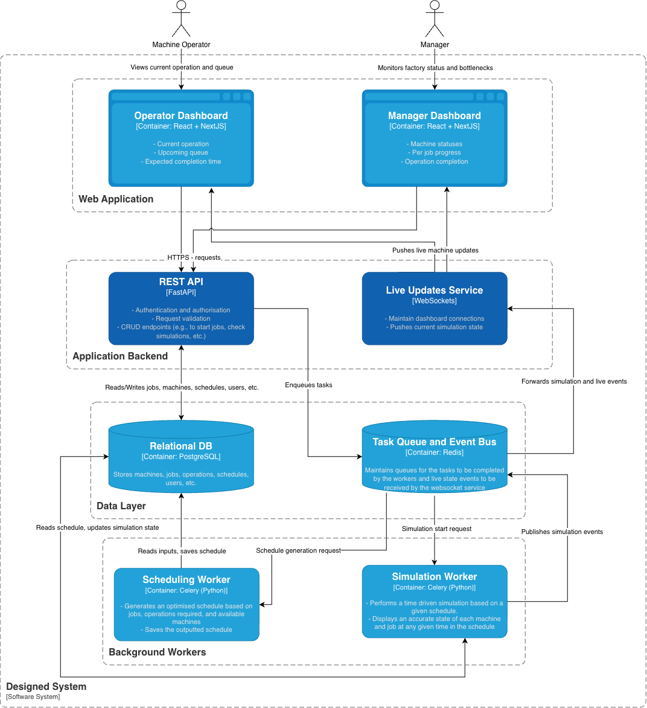
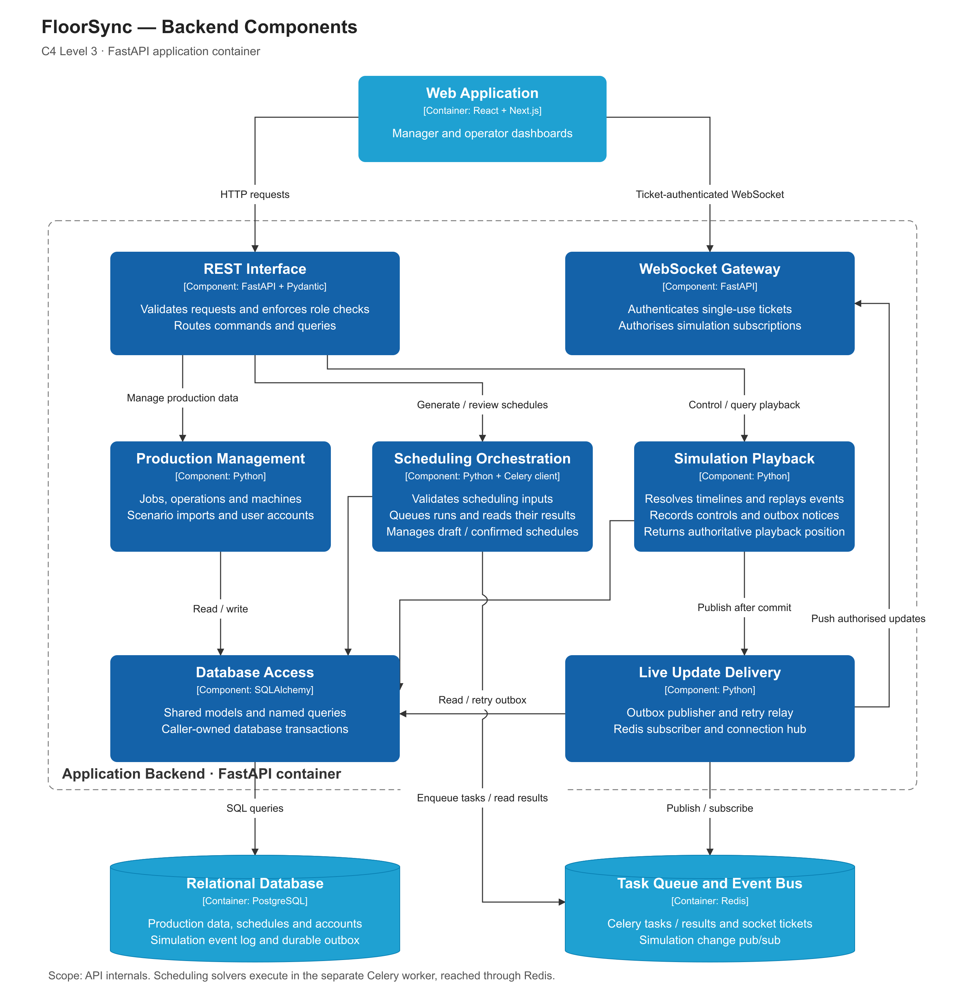
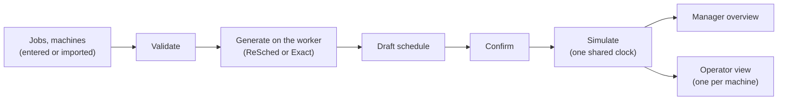

# FloorSync

Flexible job shop scheduling, simulation and live operations management. DECO3801 project 13, Team 61
(Cuffington & Co).

A production manager selects jobs and generates a schedule that assigns every operation to a
compatible machine with start and end times. The schedule then plays out in a time-driven
simulation, while the manager watches every machine and job on a live overview and each operator
follows their own machine's queue.

## Submission documents

| Document | Location |
| --- | --- |
| Signed team cover sheet | [Signed Team Cover Sheet.pdf](Signed%20Team%20Cover%20Sheet.pdf) |
| Original contribution statement | [Below](#original-contribution-statement) |
| AI-use declarations | [ai-declarations.md](ai-declarations.md) |
| Project brief | [spec/project-brief.png](spec/project-brief.png) |
| Statement of Work and Team Charter | [spec/statement-of-work/](spec/statement-of-work/summary.md) |

## Links

| What | Where |
| --- | --- |
| Repository | <https://github.com/Studio3Build-2026s2/team-61-cuffington-and-co> |
| Project board (epics, features, user stories) | <https://github.com/orgs/Studio3Build-2026s2/projects/64> (course organisation members only) |
| Deployment | None hosted: FloorSync runs locally with Docker Compose ([why](spec/requirements/requirement-changes.md), CHG-10) |
| Benchmark instances | [ScheduleOpt benchmarks](https://github.com/ScheduleOpt/benchmarks), vendored in [src/database/seed-data/](src/database/seed-data/README.md) |
| ReSched (baseline scheduler) | [XiangjieXiao/ReSched](https://github.com/XiangjieXiao/ReSched), included as a git submodule |
| Gurobi academic licence (optional, for the Exact strategy) | <https://www.gurobi.com/academia/academic-program-and-licenses/> |

## Getting started

You need [Git](https://git-scm.com/downloads) and [Docker Desktop](https://docs.docker.com/get-docker/)
(or Docker Engine with Compose v2.1 or later), running. On Windows, use WSL or Git Bash for the
script.

```bash
git clone --recurse-submodules https://github.com/Studio3Build-2026s2/team-61-cuffington-and-co.git
cd team-61-cuffington-and-co
deployment/run-local.sh
```

The script creates `.env`, runs `docker compose up --build -d --wait`, seeds a benchmark scenario
and creates a manager account. Everything else (Python and Node packages, PostgreSQL and Redis
images, the ReSched model weights) is downloaded during the first build, which takes several
minutes. Later runs start in seconds.

Then open <http://localhost:3000> and sign in as `manager` / `floorsync-dev`. Operators sign in
with their machine's name, for example `abz5-m0` / `floorsync-dev`. The API documentation is at
<http://localhost:8002/docs>.

Without the script, the same steps by hand:

```bash
cp .env.example .env
docker compose up --build -d --wait
docker compose run --rm api python -m floorsync_common.seed abz5
docker compose run --rm api python scripts/create_manager.py
```

Stop with `docker compose stop`. The Exact strategy also needs a Gurobi licence file
(`gurobi.lic`) in the repository root; without one, ReSched still works.
[deployment/README.md](deployment/README.md) is the full guide: the deployment files, a demo
walkthrough, the licence, configuration, troubleshooting and known limitations.

## Architecture

Containers (C4 level 2):



Inside the FastAPI application (C4 level 3):



| Container | Technology | Role |
| --- | --- | --- |
| Frontend | Next.js, React, TypeScript, TanStack Query | Manager and operator pages in the browser |
| API | FastAPI, SQLAlchemy (async), Alembic | REST API, WebSocket live updates, simulation clock, outbox relay |
| Worker | Celery | Generates schedules with ReSched (learned policy) or Exact (Gurobi with OR-Tools CP-SAT) |
| PostgreSQL | PostgreSQL 16 | Production data, schedules, simulations, accounts, live-update outbox |
| Redis | Redis 7 | Celery broker, live-update publish and subscribe, one-time WebSocket tickets |

How a schedule moves through the system, from the brief's pipeline:



Every diagram, including the outbox and playback patterns, the ERDs and the runtime sequences, is
in the [diagram catalogue](docs/diagrams/README.md) with its editable source. The database schema is
in [docs/database-schema.md](docs/database-schema.md), [docs/architecture.md](docs/architecture.md)
covers code boundaries, and the [decision records](docs/decisions/README.md) explain the main
choices.

## Original contribution statement

**Developed by the team**

- **Frontend:** the sign-in page and every manager and operator page (Overview, Jobs, Import, Planner, Schedules,
  Simulation, Machines, Settings, Operator), the schedule timeline, the job dependency graph and the
  live-update client.
- **Backend API:** every FastAPI feature (auth, machines, jobs and operations, schedules,
  simulation, import, operator accounts, live updates) and the service layer behind them.
- **Database:** the schema, all Alembic migrations, and the seed loader that reads the benchmark
  formats.
- **Scheduling:** input validation, the adapter that runs ReSched on FloorSync data, and the Exact
  strategy. Exact is our implementation of critical-path logic-based Benders decomposition from
  Naderi and Roshanaei (2022), with deliberate deviations listed at the top of
  [FJSP_lbbd.py](src/backend/common/floorsync_common/scheduling/FJSP_lbbd.py). The first Exact
  solver, a Gurobi MILP, followed the Dauzère-Pérès et al. formulation ([ADR 0014](docs/decisions/0014-fajsp_milp_formulation.md)).
- **Simulation and live updates:** the server-side simulation clock, the transactional outbox,
  the Redis relay and the WebSocket delivery with one-time tickets.
- **File import:** the FloorSync JSON format, the benchmark-format readers and the dry run.
- **Engineering and evaluation:** the automated tests, CI, Docker set-up, documentation, the
  benchmark comparison and the usability study.

**Used unchanged from existing sources**

- **ReSched** learned scheduling policy and trained weights ([XiangjieXiao/ReSched](https://github.com/XiangjieXiao/ReSched), MIT):
  the fast strategy and the evaluation baseline, called through our adapter.
- **Benchmark instances and best known results** ([ScheduleOpt/benchmarks](https://github.com/ScheduleOpt/benchmarks), CC BY-SA 4.0):
  the seed scenarios, import formats and evaluation data.

**Adapted from existing sources**

- **Intent UI** components ([intentui.com](https://intentui.com), MIT): buttons, fields, dialogs and
  other parts in `src/frontend/components/ui/`, added from its registry and then edited.

**Existing tools and libraries**

Next.js, React, TypeScript, TanStack Query, React Aria and Tailwind CSS on the frontend; FastAPI,
SQLAlchemy, Alembic, Pydantic and Celery on the backend; PostgreSQL and Redis for storage and
messaging; Gurobi and OR-Tools CP-SAT inside the Exact strategy; PyTorch and NumPy to run ReSched.
Every dependency and its licence is in [docs/external-resources/](docs/external-resources/README.md).

**AI tools**

Claude Code (five members) and Codex (one member) were used to explain concepts, weigh design
options, debug, and help implement small parts of features step by step. Every change was reviewed,
tested and committed by a team member. Details and prompt logs are in
[ai-declarations.md](ai-declarations.md).

## Repository map

```text
.
├── deployment/          setup guide and run-local.sh
├── design/              inspiration, wireframes and UI evolution
├── docs/                architecture, conventions, decisions, risks, meeting notes
│   ├── decisions/       architecture decision records (ADRs)
│   ├── diagrams/        architecture, pattern, data and sequence diagrams
│   ├── meeting-notes/   team and client meeting minutes
│   └── risks/           risk register
├── evidence/            evaluation and contribution evidence
│   ├── ai-prompts/      each member's AI prompt log
│   ├── benchmarks/      ReSched against Exact results and charts
│   ├── testing/         backend test and coverage evidence
│   ├── user-testing/    usability test plan, script and results
│   ├── weekly-contribution/  weekly contribution reviews
│   └── traceability.md  testing findings traced to fixes and tests
├── scripts/             create_manager.py, OpenAPI export, benchmark script
├── spec/                requirements, statement of work and team charter, user stories
├── src/
│   ├── frontend/        Next.js app (features/, core/, components/)
│   ├── backend/
│   │   ├── api/         FastAPI routes and schemas, one folder per feature
│   │   ├── common/      shared services, models, scheduling and simulation
│   │   ├── workers/     Celery scheduling tasks
│   │   └── third_party/ ReSched (git submodule)
│   └── database/
│       ├── migrations/  Alembic migrations
│       └── seed-data/   benchmark instances and their solutions
└── tests/
    ├── backend/         unit and API tests
    └── integration/     tests against a real PostgreSQL
```

## Development

```bash
make bootstrap       # once: submodules, uv sync, pnpm install
make check           # formatting, linting, type checks, tests, frontend build, OpenAPI check
make install-hooks   # optional: run make check before every push
```

`make check` needs [uv](https://docs.astral.sh/uv/) and Node.js 22 on the host. CI runs the same
gate on every pull request. [CONTRIBUTING.md](CONTRIBUTING.md) and
[docs/pull-requests.md](docs/pull-requests.md) describe how changes are made and reviewed.

## Documentation and evidence

- [System diagrams](docs/diagrams/README.md): architecture, components, outbox and playback patterns, ERDs and runtime sequences
- [Specification](spec/README.md): requirements, success criteria, changes and user stories
- [Design](design/README.md): inspiration, wireframes and how the UI evolved
- [Scheduling](docs/scheduling.md) and [the scheduling and simulation backend](docs/scheduling-simulation-backend.md)
- [Importing production data](docs/importing.md) and [accounts and signing in](docs/accounts.md)
- [Decision records](docs/decisions/README.md), [risk register](docs/risks/README.md) and [meeting notes](docs/meeting-notes/README.md)
- [Benchmarks](evidence/benchmarks/), [testing](evidence/testing/README.md), [user testing](evidence/user-testing/README.md) and [traceability](evidence/traceability.md)
- [Weekly contribution reviews](evidence/weekly-contribution/README.md)
- [All documentation](docs/README.md)

## Team

| Member | GitHub | Responsibility |
| --- | --- | --- |
| Riley Rushton | [rileyrushton05](https://github.com/rileyrushton05) | Domain models and data: schema, migrations, seeding, data APIs, import, schedule lifecycle |
| Jason Zhong | [jzhong00](https://github.com/jzhong00) | System foundations: scaffold, conventions, authentication, CI, frontend architecture |
| Ben Cuffe | [Wugene1](https://github.com/Wugene1) | Scheduling engine: the Exact solver and the benchmark evaluation |
| Beth McMeechan | [bethmcm16](https://github.com/bethmcm16) | Production simulation: simulation engine, live updates, usability testing |
| Xavier Alderson | [xjalder](https://github.com/xjalder) | Frontend interfaces: dashboards, planner, simulation playback, settings |
| Jayden Phan | [jjjeidennn](https://github.com/jjjeidennn) | Frontend interfaces: manager pages, UI polish, design |
