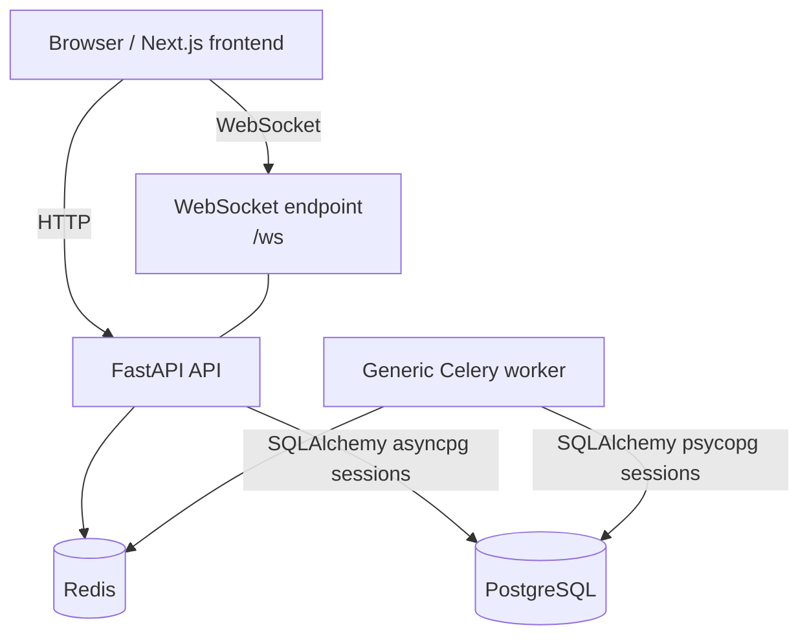

# Technical Foundation

## Purpose

This document describes the FloorSync development foundation: the services that run locally, their code boundaries and the interfaces used to connect them.

## Current architecture



## Component responsibilities

| Component | Use it for |
| --- | --- |
| `src/frontend/` | Next.js/TypeScript UI. Add application routes, reusable components and API/WebSocket clients here. |
| `src/backend/api/` | FastAPI HTTP and WebSocket transport. Add request validation, API routes and connection handling here. |
| `src/backend/common/` | Code shared by API and workers: settings, SQLAlchemy models, async sessions, typed contracts and domain utilities. |
| `src/backend/workers/` | Celery application and asynchronous task modules. Workers consume jobs from Redis. |
| `src/database/` | Alembic migrations and seed data. This is the database workstream’s ownership area. |
| Redis | Celery broker and result backend. It can also support event publication for live updates. |
| PostgreSQL | Relational data store for application data. |

Product API code is organised by feature, while shared database infrastructure and ORM models remain
centralised. The mandatory implementation rules are defined in the
[backend conventions](backend-conventions.md) and
[observability conventions](observability-conventions.md).

## Interfaces available today

| Interface | Purpose |
| --- | --- |
| `GET /health` | Confirms that the FastAPI service is running. |
| `WS /ws` | Accepts a client, sends `{"type":"connected"}`, and keeps the connection open. |
| Celery worker | Runs asynchronous task modules with Redis connectivity. |
| API database session | Provides request-scoped async database access to API routes. |
| Worker database scope | Provides a synchronous, process-local transaction for Celery tasks. |

## Dependency rule

`common` is the shared kernel. Both API and workers may import it, but it must not import either of them. This avoids circular dependencies and lets the team add worker tasks or API routes independently.

```text
frontend → API → common
worker   → common
migrations → common database models
```

## Local development

Docker Compose starts frontend, API, worker, Redis and PostgreSQL together. Copy `.env.example` to `.env`, then run:

```bash
docker compose up --build -d
make db-upgrade
```

- Frontend: <http://localhost:3000>
- API health: <http://localhost:8002/health>
- API documentation: <http://localhost:8002/docs>
- WebSocket endpoint: `ws://localhost:8002/ws`

Schema changes are managed with Alembic. Add ORM models under
`floorsync_common.database.models`, import each module from that package, then run
`make db-revision name="describe the schema change"` and review the generated migration. Apply
migrations with `make db-upgrade`; application startup deliberately does not create or mutate the
schema.

Celery workers use a separate synchronous driver and create their pool after each worker process
starts. See the
[Celery database decision](decisions/0001-celery-database-access.md).

## Quality gates

- **Docker Compose** provides the reproducible development environment for all six members.
- **Ruff** provides fast formatting and linting for Python.
- **Mypy strict** protects the contracts between the API, shared code and workers while the project is still small.
- **Pytest** begins with service health and grows with each feature.
- **TypeScript strict** applies to the Next.js frontend from the start.

Run the full backend and frontend quality suite with `make check` after running `make bootstrap`.
