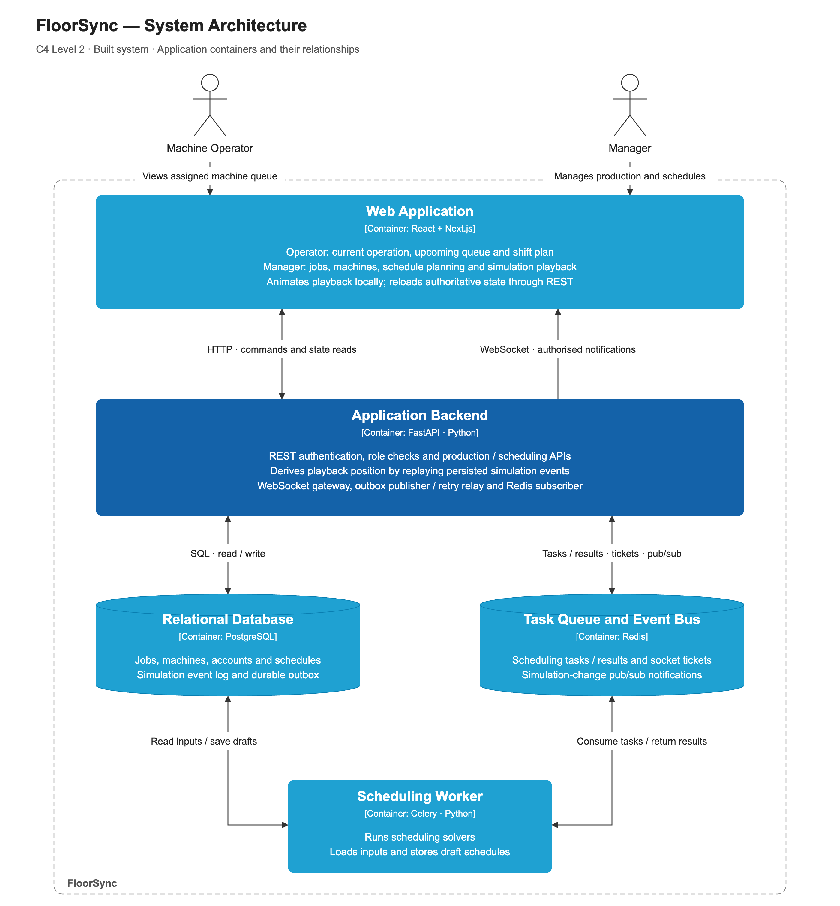
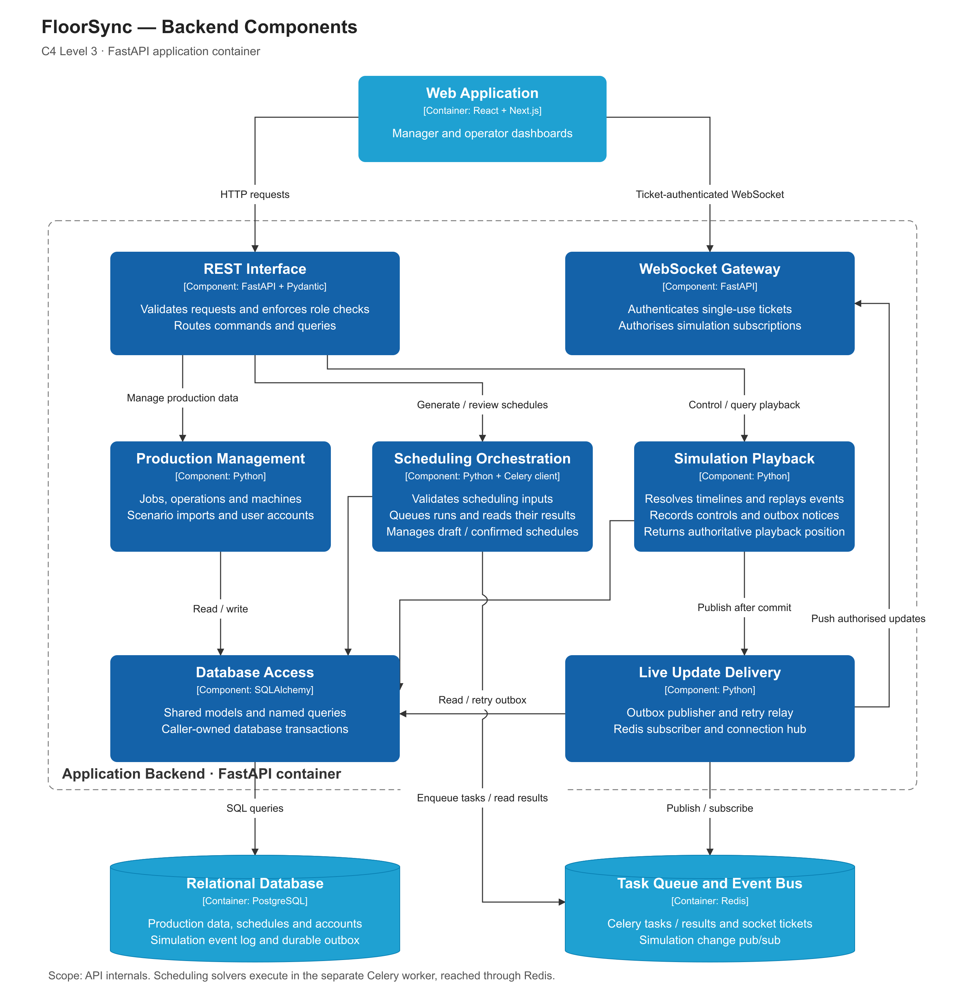

# Technical Foundation

## Purpose

This document describes the FloorSync development foundation: the services that run locally, their code boundaries and the interfaces used to connect them.

See the [core system diagrams](diagrams/README.md) for the architecture, data model and key runtime flows.

## System architecture

The container view shows the built system. The FastAPI application derives simulation position by replaying persisted events ([ADR 0010](decisions/0010-event-sourced-simulated-time.md)) and hosts WebSocket delivery and outbox retries ([ADR 0017](decisions/0017-live-update-outbox.md)). Celery workers execute scheduling tasks.



[Open the full-size architecture diagram](diagrams/architecture/system-architecture.png) · [Editable draw.io source](diagrams/sources/system-architecture.drawio).

## Backend components

The component view looks inside the FastAPI application container. The web application, PostgreSQL and Redis remain outside this boundary.



[Editable draw.io source](diagrams/sources/backend-components.drawio).

## Reliability and playback

The [transactional outbox](diagrams/patterns/transactional-outbox.png) makes the simulation change and its notification atomic; publication and retries happen after commit. [Decision 0017](decisions/0017-live-update-outbox.md) contains the diagram and its delivery guarantees.

The [event-sourced playback diagram](diagrams/patterns/event-sourced-playback.png) separates authoritative event replay from local animation. [Decision 0010](decisions/0010-event-sourced-simulated-time.md) contains the diagram and the clock-authority rationale.

For request ordering, see the [schedule-generation sequence](diagrams/sequences/schedule-generation.png) and [simulation/live-update sequence](diagrams/sequences/simulation-live-updates.png).

## Component responsibilities

| Component | Use it for |
| --- | --- |
| `src/frontend/` | Next.js/TypeScript UI. Add application routes, reusable components and API/WebSocket clients here. |
| `src/backend/api/` | FastAPI HTTP and WebSocket transport. Add request validation, API routes and connection handling here. |
| `src/backend/common/` | Code shared by API and workers: settings, SQLAlchemy models, async sessions, typed contracts and domain utilities. |
| `src/backend/workers/` | Celery application and asynchronous task modules. Workers consume jobs from Redis. |
| `src/database/` | Alembic migrations and seed data. This is the database workstream’s ownership area. |
| Redis | Celery broker and result backend. It also carries live-update publication and one-time WebSocket tickets. |
| PostgreSQL | Relational data store for application data. |

Product API code is organised by feature, while shared database infrastructure and ORM models remain
centralised. The mandatory implementation rules are defined in the
[backend conventions](backend-conventions.md) and
[observability conventions](observability-conventions.md).

The scheduling adapter is a pure shared-domain module so the API, worker and benchmark runners use
the same ReSched input/output translation. Its supported input contract and persistence boundary are
documented in [scheduling.md](scheduling.md).

## Interfaces available today

| Interface | Purpose |
| --- | --- |
| `GET /health` | Confirms that the FastAPI service is running. |
| `WS /ws` | Authenticates using a single-use ticket, authorises simulation subscriptions, and sends snapshot/change notifications. |
| Celery worker | Runs asynchronous task modules with Redis connectivity. |
| API database session | Provides request-scoped async database access to API routes. |
| Worker database scope | Provides a synchronous, process-local transaction for Celery tasks. |

## Dependency rule

`common` is the shared kernel. Both API and workers may import it, but it must not import either of them. This avoids circular dependencies and lets the team add worker tasks or API routes independently.

```text
frontend → API → common
worker   → common
migrations → common database models
```

## Local development

Docker Compose starts frontend, API, worker, Redis and PostgreSQL together. Copy `.env.example` to `.env`, then run:

```bash
docker compose up --build -d
```

- Frontend: <http://localhost:3000>
- API health: <http://localhost:8002/health>
- API documentation: <http://localhost:8002/docs>
- WebSocket endpoint: `ws://localhost:8002/ws`

Schema changes are managed with Alembic. Add ORM models under
`floorsync_common.database.models`, import each module from that package, then run
`make db-revision name="describe the schema change"` and review the generated migration. Apply
migrations with `make db-upgrade`. In local Compose, the API startup command applies outstanding
Alembic revisions before serving and the worker waits for API health; production deployments still
run migrations as an explicit release step.

Celery workers use a separate synchronous driver and create their pool after each worker process
starts. See the
[Celery database decision](decisions/0001-celery-database-access.md).

## Quality gates

- **Docker Compose** provides the reproducible development environment for all six members.
- **Ruff** provides fast formatting and linting for Python.
- **Mypy strict** protects the contracts between the API, shared code and workers while the project is still small.
- **Pytest** begins with service health and grows with each feature.
- **TypeScript strict** applies to the Next.js frontend from the start.

Run the full backend and frontend quality suite with `make check` after running `make bootstrap`.
