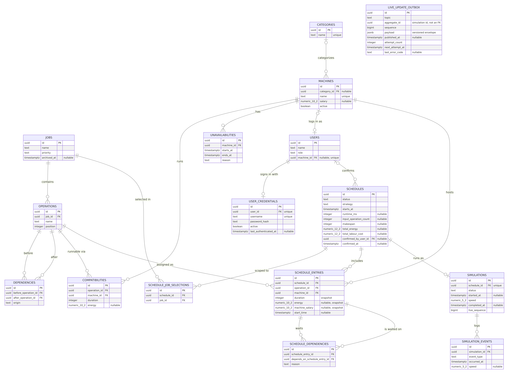

# Database schema

Logical, table-by-table translation of the [Schedule Storage ER diagram](diagrams/schedule-storage-erd.png)
(#125), checked against [database-conventions.md](database-conventions.md). This is the reference for
building the SQLAlchemy models and the first Alembic migration (#175 / US53) — every table below maps to
one model file under `floorsync_common/database/models/`.

All tables get `id` (UUID v4, `UUIDPrimaryKeyMixin`) and `created_at` / `updated_at`
(`TimestampMixin`) unless noted. Omitted below for brevity.



## categories

Lookup table for machine categories (cutting, polishing, metal cutting, ...), so the platform stays
general-purpose rather than glass-cutting-specific.

| column | type | constraints |
|---|---|---|
| name | Text | not null, unique |

## machines

| column | type | constraints |
|---|---|---|
| category_id | Uuid | FK -> categories.id, nullable, ondelete RESTRICT, indexed |
| name | Text | not null, unique |
| salary | Numeric(10,2) | nullable |
| active | Boolean | not null, default true |

`salary` is the cost of running this machine (including the operator wage it requires), known at
setup time — not derived from whoever is actually rostered on it. This is what lets the scheduler
price a schedule the day before, without waiting on rostering to be finalised.

`salary` and `category_id` are nullable because not every source of machine data records them. An
academic job-shop benchmark (see `src/database/seed-data/`) describes a machine only as an index
with per-operation durations, so a machine seeded from one has no category and no known cost. **NULL
means "not recorded by the source this machine came from", not "free" or "uncategorised"** — cost
reporting must exclude such a machine rather than sum it as zero. Machines entered through the
manager UI are expected to carry both.

`active` exists because a machine can't be deleted once it has any real history (compatibilities,
schedule entries — see Deletion policy below), so decommissioning one has to be a flag, not a row
removal. Machine-selection UI and the scheduler both filter on `active = true`.

## unavailabilities

Known-in-advance machine downtime — maintenance, a reserved slot, a public holiday — read once when
a schedule is generated. This is deliberately **not** the live/dynamic failure handling the team
scoped out (Unavailability was cut earlier specifically because it was tied to *rescheduling on the
day*; this is a plain input fact known the day before, in the same category as Compatibility or
Dependency).

| column | type | constraints |
|---|---|---|
| machine_id | Uuid | FK -> machines.id, not null, ondelete CASCADE, indexed |
| starts_at | DateTime(timezone=True) | not null |
| ends_at | DateTime(timezone=True) | not null |
| reason | Text | not null |

```sql
CHECK (ends_at > starts_at)
-- recommended: prevent overlapping windows for the same machine
EXCLUDE USING gist (machine_id WITH =, tstzrange(starts_at, ends_at) WITH &&)
```

`ondelete CASCADE` is safe here — an unavailability window has no downstream historical reference
pointing at it, so deleting a machine's windows alongside the machine (which, per `active` above,
should itself be rare) destroys nothing anyone needed to keep.

## Shift and break times: not a table

No `shifts` or `breaks` table. The factory runs fixed hours nobody edits through the UI, so this is
plain application config, not data — a constant, not rows with a migration behind them.

It's also not a scheduling input at all, which took a couple of wrong turns to land on. The chain of
reasoning, since it matters for anyone extending this later:

- A machine's login belongs to the **machine**, not a specific person ("each machine has its own
  login") — so when someone covers a colleague's break, they're just using the same login. The
  machine was never actually unavailable, and nothing needs to model who's covering whom.
- That only holds if breaks are staggered. If every operator broke at once, there'd be no one free
  to cover, and the whole "machines never pause" reasoning would collapse.
- So a machine is never really "on break" — it's continuously staffed by back-to-back handovers
  (Worker A 6:00–9:45, Worker B 9:45–10:00, Worker A again 10:00–14:00). What reads as "Worker A's
  break" from a person's side is just a normal handover from the machine's side. The underlying
  shape is one flat, ordered list of handover timestamps per machine (or per staggered group) — the
  last one each day is shift end, everything earlier is a break — not two separate "shift" and
  "break" concepts.
- `unavailabilities` above remains the only thing that ever makes a machine genuinely
  unschedulable — actually broken, or actually reserved.
- The operator dashboard's countdown runs on **real wall-clock time**, never simulated time — a
  person's actual break happens at real 10am regardless of simulation speed. It has nothing to do
  with `Simulation` / `SimulationEvent`.

## users

| column | type | constraints |
|---|---|---|
| name | Text | not null |
| role | Text | not null, CHECK role IN ('operator', 'manager') |
| machine_id | Uuid | FK -> machines.id, nullable, **unique**, ondelete SET NULL, indexed |

```sql
CHECK ((role = 'operator') = (machine_id IS NOT NULL))
```

A User is a login. For `role = 'operator'` it's permanently tied to exactly one machine (the unique
constraint enforces the 1:1 — "each machine has its own login"); `manager` accounts (which now cover
what used to be the separate coordinator role, per the Statement of Work change) have no machine and
log in independently.

## user_credentials

Authentication data is deliberately separate from `users`: FloorSync's production/user model remains
usable by scheduling and auditing code without carrying password material. Exactly one credential may
belong to a user; no credential can exist without its user.

| column | type | constraints |
|---|---|---|
| user_id | Uuid | FK -> users.id, not null, unique, ondelete RESTRICT, indexed |
| username | Text | not null, unique, stored lowercase |
| password_hash | Text | not null — Argon2 hash only |
| active | Boolean | not null, default true |
| last_authenticated_at | DateTime(timezone=True) | nullable |

JWTs are short-lived API credentials, not database records. The API validates their signature and
claims, then reloads the active credential and its user on each protected request. This lets a manager
disable a credential without waiting for an old token to expire.

## jobs

| column | type | constraints |
|---|---|---|
| name | Text | not null |
| priority | Text | not null, default 'med', CHECK priority IN ('high', 'med', 'low') |
| archived_at | DateTime(timezone=True) | nullable, indexed |

Jobs are independent of one another: there is no job-to-job dependency table or column, by design.
Precedence is an operation-level fact on `dependencies`, and an edge may cross jobs only at that
level. `priority` is lower-case in the database and API; the frontend maps to its own labels.

`archived_at` is how a job leaves the backlog without being deleted (decision 0015). NULL means the
job is open; a timestamp means it finished or was cancelled then. It is set for every job in a
schedule whose simulation completes, or by hand through the jobs API. Listing and whole-floor
generation skip archived jobs, and a precedence edge touching one is treated as satisfied. It is a
timestamp rather than a flag because *when* a job left the backlog is the fact worth keeping, and
the flag is derivable from it. Archiving never unlocks deletion: a job a confirmed schedule planned
stays undeletable, which is the whole reason archiving exists.

## operations

| column | type | constraints |
|---|---|---|
| job_id | Uuid | FK -> jobs.id, not null, ondelete CASCADE, indexed |
| name | Text | not null |
| position | Integer | not null, CHECK position >= 1 |

```sql
UNIQUE (job_id, position) DEFERRABLE INITIALLY DEFERRED
```

`ondelete CASCADE` because an operation has no independent lifecycle apart from its job.

`position` is the step's place in its job as the job builder shows and edits it -- a stable, 1-based
display order that the API keeps contiguous. It is **not** precedence: that stays on `dependencies`,
which can express shapes a single number cannot (a step waiting on several others). The
job-definition save endpoint (tracked separately, #235) is expected to derive a straight chain of
`builder_sequence` edges from consecutive positions; anything richer is written to `dependencies`
directly and would be left untouched by such a save.

The unique constraint is deferred to commit so a reorder can be written as one set of updates.
Checked immediately, swapping two positions would fail on the first update because the second row
still holds the value being moved to. The database still refuses a duplicate -- at the end of the
transaction rather than half-way through the reorder.

## dependencies

Self-reference on `operations`, supporting multiple predecessors per operation. Process-level and
persists independently of any schedule.

| column | type | constraints |
|---|---|---|
| before_operation_id | Uuid | FK -> operations.id, not null, ondelete CASCADE, indexed |
| after_operation_id | Uuid | FK -> operations.id, not null, ondelete CASCADE, indexed |
| origin | Text | not null, default 'external', CHECK origin IN ('external', 'builder_sequence') |

```sql
UNIQUE (before_operation_id, after_operation_id)
CHECK (before_operation_id <> after_operation_id)
```

`origin` records who owns the row, so a future job-definition save (#235) can rewrite its own edges
without touching anyone else's. `builder_sequence` is meant for an edge derived from two consecutive
operation positions, to be deleted and re-derived on every save of that job. `external` is
everything else -- a benchmark import, or an edge written through the ordering API -- and is what
every edge this PR writes is tagged as, since nothing here derives an edge from position. There is
deliberately no job-level origin: jobs are independent, and precedence only ever joins operations.

## compatibilities

Which machines can run which operations, and what it costs when they do.

| column | type | constraints |
|---|---|---|
| operation_id | Uuid | FK -> operations.id, not null, ondelete CASCADE, indexed |
| machine_id | Uuid | FK -> machines.id, not null, ondelete RESTRICT, indexed |
| duration | Integer | not null — minutes |
| energy | Numeric(10,2) | nullable |

```sql
UNIQUE (operation_id, machine_id)
```

`ondelete RESTRICT` on machine_id — a machine with recorded compatibility history shouldn't
disappear silently.

`energy` is nullable for the same reason as `machines.salary`: duration is the only cost an academic
benchmark instance records. NULL means "not recorded by the source", not "draws no power".

## schedules

| column | type | constraints |
|---|---|---|
| status | Text | not null, CHECK status IN ('draft', 'confirmed', 'discarded') |
| strategy | Text | not null |
| runtime_ms | Integer | nullable — elapsed engine time only, excluding database/API work |
| input_operation_count | Integer | nullable — number of operations in this run's input |
| makespan | Integer | nullable — set once generation completes |
| total_energy | Numeric(12,2) | nullable — set once generation completes |
| total_labour_cost | Numeric(12,2) | nullable — set once generation completes |
| confirmed_by_user_id | Uuid | FK -> users.id, nullable, ondelete SET NULL, indexed |
| confirmed_at | DateTime(timezone=True) | nullable |

`strategy` stays as a label even though only one strategy is built, so a second one doesn't need a
migration to add later. A draft is deleted outright when abandoned, entries and all, because a draft
nobody confirmed records nothing and the FK on its entries would otherwise keep blocking edits to
the jobs it named; `discarded` is reserved for a confirmed schedule that is later withdrawn
(decision 0015, see Deletion policy below). `confirmed_by_user_id` / `confirmed_at` are the audit trail for
who actually handed a schedule off to simulation and when; `ondelete SET NULL` so a later change to
the confirming user's account never threatens the schedule record itself. `total_energy` /
`total_labour_cost` are written once at generation, summed from `schedule_entries` below — the same
kind of cached, never-reconciled-against-anything-else value `makespan` already is, needed because
the objective function is multi-objective now, not makespan alone. `runtime_ms` and
`input_operation_count` are run metadata used to compare deterministic scheduling strategies over
the same-sized input.

## schedule_entries

`start_time` is written by the scheduler at generation time and read as-is by the simulation
package — see decision 0011. It is nullable only because a schedule generated before that decision
has no value to backfill without the derivation it replaces; such a schedule must be regenerated
before it can be simulated. End time and queue position are still derived, never stored, as
`start_time + duration` and by sorting a machine's entries on `start_time`.

| column | type | constraints |
|---|---|---|
| schedule_id | Uuid | FK -> schedules.id, not null, ondelete RESTRICT, indexed |
| operation_id | Uuid | FK -> operations.id, not null, ondelete RESTRICT, indexed |
| machine_id | Uuid | FK -> machines.id, not null, ondelete RESTRICT, indexed |
| duration | Integer | not null — snapshotted from Compatibility at generation time |
| energy | Numeric(10,2) | nullable — snapshotted from Compatibility at generation time |
| machine_salary | Numeric(10,2) | nullable — snapshotted from Machine at generation time |
| start_time | DateTime(timezone=True) | nullable — see above; set on every schedule generated from decision 0011 onward |

`operation_id` / `machine_id` preserve **identity** — which real Operation and Machine were
used — and that's enough for display purposes; a later rename doesn't need to rewrite history.
`duration`, `energy`, and `machine_salary` preserve **cost**, and identity isn't enough for those:
if `Machine.salary` changes next month, a schedule generated today has to keep reporting what it
actually cost *today*, not silently recalculate against tomorrow's rate. Same snapshot reasoning
Compatibility's duration already had, just extended to the other two numbers the objective function
now uses.

`energy` and `machine_salary` are nullable because what they snapshot is: a scenario seeded from an
academic benchmark has no cost data to copy. `duration` stays required — an entry without one can't
be sequenced, and every source records it. A schedule generated from a benchmark scenario is
therefore schedulable and simulatable but not costable, which is the honest outcome.

```sql
UNIQUE (schedule_id, operation_id)
```

`duration` is copied at generation time rather than calculated from live Compatibility data, so a
later edit cannot silently reshape a schedule that's already been generated.

## schedule_dependencies

Rebuilt from scratch every time a schedule is generated — see #125 for why this is a disposable
cache and not an independent source of truth. It backs `GET /schedules/{id}`'s dependency-graph
response; the simulation package no longer reads it to place operations on the clock now that
`schedule_entries.start_time` carries that directly (decision 0011).

| column | type | constraints |
|---|---|---|
| schedule_entry_id | Uuid | FK -> schedule_entries.id, not null, ondelete CASCADE, indexed |
| depends_on_schedule_entry_id | Uuid | FK -> schedule_entries.id, not null, ondelete CASCADE, indexed |
| reason | Text | not null, CHECK reason IN ('job_order', 'machine_queue') |

```sql
UNIQUE (schedule_entry_id, depends_on_schedule_entry_id)
CHECK (schedule_entry_id <> depends_on_schedule_entry_id)
```

## schedule_job_selections

Which jobs a schedule was *asked* to plan, when the request named a subset of the backlog rather
than the whole floor — see #231 and decision 0013.

| column | type | constraints |
|---|---|---|
| schedule_id | Uuid | FK -> schedules.id, not null, ondelete CASCADE, indexed |
| job_id | Uuid | FK -> jobs.id, not null, ondelete RESTRICT, indexed |

```sql
UNIQUE (schedule_id, job_id)
```

Shaped like `schedule_dependencies`: a surrogate UUID key like every other table, with the pairing
held by a unique constraint so a schedule names a job at most once.

**Absence is meaningful.** No rows for a schedule means it was generated for the whole floor, which
is true of every schedule made before this table existed and of every unscoped run since. That never
collides with a scoped run, because a scoped run always names at least one job — an empty selection
is refused before generation starts.

Not derivable from `schedule_entries`. The entries record which operations were *placed*, which
answers "what got planned" and not "what was asked for"; the two differ whenever a selected job turns
out to hold no schedulable work. `job_id` is `RESTRICT` for the same reason
`schedule_entries.operation_id` is: a schedule is a record of a decision, and deleting a job it names
would quietly rewrite that record.

Note that this records job *selection*, not job *precedence*. There is still deliberately no
job-level dependency anywhere in this schema — which jobs wait on which is derived from
`dependencies` on demand, per decision 0013.

## simulations

| column | type | constraints |
|---|---|---|
| schedule_id | Uuid | FK -> schedules.id, not null, **unique**, ondelete RESTRICT |
| status | Text | not null, CHECK status IN ('not_started', 'running', 'paused', 'complete') |
| started_at | DateTime(timezone=True) | nullable — null until started |
| speed | Numeric(5,2) | not null, default 1 |
| completed_at | DateTime(timezone=True) | nullable |

One simulation per schedule; reset re-initialises this row rather than creating a new one.

**`started_at` + `speed` alone can't correctly derive simulated time across a pause.** `elapsed =
(now - started_at) * speed` keeps advancing in real time even while paused, which breaks "preserve
simulated position" (US24/#146's own acceptance criteria). See `simulation_events` below — that's
the actual fix, not an extra column here.

## simulation_events

An append-only log of every playback control action. This does two jobs at once: it's what makes
pause/resume/speed-change derivation correct (simulated time is computed by replaying this log
against `speed`, rather than trusting a single mutable anchor that pause has to keep rewriting), and
it's the audit trail for "who did what, when" that logging-after-the-fact needs — for free, since the
data has to exist anyway.

| column | type | constraints |
|---|---|---|
| simulation_id | Uuid | FK -> simulations.id, not null, ondelete CASCADE, indexed |
| event_type | Text | not null, CHECK event_type IN ('started', 'paused', 'resumed', 'speed_changed', 'reset', 'completed') |
| occurred_at | DateTime(timezone=True) | not null, server_default now() |
| speed | Numeric(5,2) | nullable — set only on 'started', 'resumed', 'speed_changed' |

`ondelete CASCADE` from Simulation is correct here in the same way it's correct for Schedule
Dependency: the event log has no meaning independent of the simulation it describes, and Simulation
itself is already RESTRICT-protected from casual deletion.

## Deletion policy

One rule, applied consistently: **never `CASCADE` across a boundary that represents something that
actually happened.** `RESTRICT` there instead, and make "get rid of it" a status value
(`machines.active = false`, `jobs.archived_at`, `schedules.status = 'discarded'` for a withdrawn
confirmed schedule) rather than a row deletion, which is also what makes post-hoc logging and
evaluation evidence trustworthy, since nothing that was ever scheduled or simulated can quietly
disappear.

"Actually happened" is the test, and a draft schedule fails it: nobody confirmed it, so it is a
proposal, not a record. A draft can therefore be deleted through the API, entries and all, and
until it is, it blocks removal of the jobs and operations it planned. A confirmed schedule blocks
them for good, and the job is archived instead (decision 0015). Every refusal names the schedules
in the way, split into drafts the caller can delete and confirmed ones it cannot. Editing a
scheduled job is always allowed; only removing an operation a schedule recorded is refused, because
everything else a save can change is already snapshotted on the schedule's own rows.

`CASCADE` is still used, deliberately, in exactly two situations:
- **Pure pre-execution config with zero independent identity** — Operation has no meaning without
  its Job, a Dependency edge has no meaning without its Operations, a Compatibility row has no
  meaning without its Operation. All three are additionally protected a second way: once any of them
  has actually been used in a real schedule, the `RESTRICT` on `schedule_entries` blocks the delete
  anyway, so the cascade only ever fires on data nothing downstream depends on.
- **Data explicitly designed to be disposable** — `schedule_dependencies` (rebuilt from scratch every
  generation, per #125) and `simulation_events` (meaningless detached from its simulation). Cascading
  these isn't a loophole, it's the documented design.

The practical effect: a `Machine`, `Job`, `Operation`, `Schedule`, or `Simulation` that has ever been
used for anything real cannot be hard-deleted at all — the FK graph refuses it. That's intentional.
"Used for anything real" starts at confirmation: a draft, and anything only a draft points at, is
still deletable.

## Open questions for the team to confirm before the migration lands

- `compatibilities.duration` as `Integer` minutes — confirm the unit before anyone hardcodes it.
- `schedule_entries.duration` is a snapshot: a confirmed plan must not change when Compatibility is
  edited later.
- `users.role` and other small fixed-value columns use a `CHECK` constraint rather than a lookup
  table, per conventions ("a check constraint or lookup table for values likely to change") —
  `category` got a table because it's genuinely open-ended (Pasindu's own set will grow); `role` and
  `status` columns didn't because their value sets are fixed by the domain, not the data.
- ~~Breaks aren't backed by any table~~ — resolved: they're not backed by a table at all, by
  design. See "Shift and break times: not a table" above. Overnight (midnight-crossing) shifts are
  out of scope for the config, deliberately not handled.
- ~~No "scenario" concept exists~~ — resolved, no schema change needed. Benchmark instances
  (ScheduleOpt, ReSched) stay **out of the database entirely** — Ben's benchmarking work reads them
  straight from files. Only one FloorSync scenario is ever live at a time (matching the
  one-simulation-at-a-time design), so US47 (#118) is just an export/reload extension of US54's seed
  loader — no `scenario_id` columns, no multi-scenario grouping.
- Cross-job Dependency edges (Job 3's Assemble step depending on both Job 1's and Job 2's Weld steps,
  from the ER diagram's worked example) are intentional and unconstrained here — nothing enforces
  `before_operation` and `after_operation` sharing a job, because they're explicitly allowed not to.
- Cycle prevention on Dependency, and machine non-overlap / precedence on the derived timeline, both
  stay application-level checks (tracked under #132 and the feasibility checker, #142/#179) rather
  than DB constraints — there's no way to express "no cycles" or "no overlapping derived intervals"
  as a plain `CHECK` when the intervals themselves aren't stored columns.
- One login per machine (no co-manned machines) is an existing team decision, not a new gap — noted
  here only so it isn't mistaken for an oversight when read against real floor operation.
