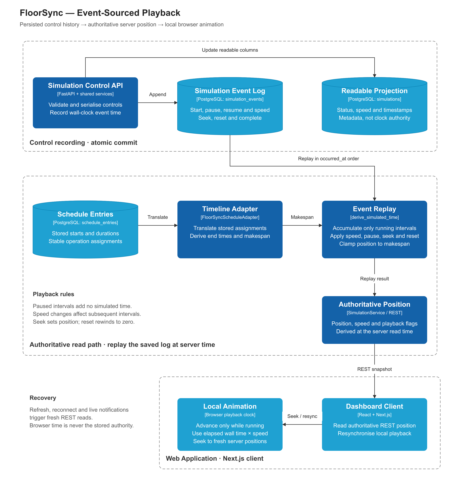

# Decision: Derive simulated time by replaying the simulation event log

## Date

2026-09-05

## Status

Accepted

## Diagram

[Editable draw.io source](../diagrams/sources/event-sourced-playback.drawio).

The [simulation/live-update sequence](../diagrams/sequences/simulation-live-updates.png) shows how notifications cause clients to reload this authoritative position.

## Context

`simulations` records `started_at` and `speed`, and the obvious reading of simulated position is
`(now - started_at) * speed`. That expression keeps advancing in real time while playback is paused,
so a simulation paused for an hour resumes an hour further along than the operator left it. US24
(#146) requires the opposite: pausing preserves position.

`docs/database-schema.md` already identifies the fix and the reason `simulation_events` exists — an
append-only log of `started`, `paused`, `resumed`, `speed_changed`, `reset` and `completed`, each
with `occurred_at` and, where relevant, the `speed` it set. What the schema does not settle is where
the replay lives, and how it relates to the clock a browser runs between frames.

There are two clocks in play and they answer different questions. A client animating a Gantt chart
needs to advance smoothly many times a second. A server answering "where is this simulation now"
needs an answer that survives a process restart, that two viewers agree on, and that a request an
hour later still gets right.

## Decision

1. Treat `simulation_events` as the authority for simulated time. A stored simulation's position is
   always derived by replaying its log; it is never read from a single mutable anchor.
2. Implement the replay as `derive_simulated_time(events, at, makespan)` in
   `floorsync_common.simulation.events` — a pure function over frozen records, returning simulated
   time, the speed in force, whether playback is running and whether it has completed.
3. Replay in `occurred_at` order and accumulate only the real time that elapsed while running, scaled
   by the speed in force over that interval. A speed change therefore applies going forward and never
   retroactively rescales time already accumulated.
4. Keep `PlaybackClock` and `SimulationEngine` as the local player. They animate between authoritative
   positions and drive headless work such as tests and exports; they are never the source of truth for
   a stored simulation.
5. Resynchronise the local player by seeking it to a derived position, rather than by trying to keep a
   long-lived in-process clock in agreement with the database.
6. Treat `simulations.status`, `started_at` and `speed` as a readable projection of the log, not as
   independent state. Where the two ever disagree, the log wins.
7. Reject unreplayable logs loudly with `SimulationTimelineError`: a naive timestamp, a
   speed-setting event with no speed recorded, a non-positive speed, or an unknown event type.

## Rationale

- Only the log distinguishes "paused for ten seconds" from "paused for an hour", because only the log
  records when playback stopped. Any single-anchor scheme has to rewrite the anchor on every pause and
  resume, and a lost write silently corrupts position.
- The derivation is a pure function, so it is exhaustively testable at the boundaries that matter —
  pause, resume, speed change, reset, completion — with no database and no waiting in real time.
- Replay is correct after a restart, and correct for a viewer who connects late, because it depends on
  nothing held in a process.
- The log is required for the audit trail regardless, so deriving position from it adds no storage and
  no second write path that could disagree with the first.
- Separating the two clocks keeps each honest: a browser animating at 60fps should not round-trip to
  PostgreSQL per frame, and a server answering an API request should not trust a number a browser has
  been incrementing.
- Sorting inside the replay means callers may pass rows in any order, so a query does not have to
  guarantee ordering to be correct.
- A malformed log is a broken invariant rather than an expected outcome, so it raises. That matches
  decision 0004: expected outcomes are returned as typed variants, and broken invariants are not.

## Alternatives considered

- **Store `elapsed_simulated_time` on `simulations` and update it on every control action:** rejected.
  It is a cached derivation of the log that must be written correctly on every path, and a missed
  update is undetectable after the fact.
- **Rewrite `started_at` on each resume so the naive formula works:** rejected. It destroys when the
  simulation actually started, which the audit trail needs, and still fails to describe a paused
  simulation without a second flag.
- **Hold the authoritative clock in the API process:** rejected. It does not survive a restart, cannot
  be shared by two workers, and gives two viewers different answers.
- **Have the client own simulated time and report it back:** rejected. It makes position unverifiable,
  disagrees between viewers, and puts a value the audit trail depends on outside the system's control.
- **Recompute and persist position on a timer:** rejected as a polling loop that adds write load and
  is still only as fresh as its last tick, to replace a function that is exact on demand.

## Consequences

- Every control action must append an event. A pause that updates only `simulations.status` will be
  invisible to the derivation, and position will keep advancing.
- `started`, `resumed` and `speed_changed` must always carry the speed they set; the replay refuses a
  log where one does not.
- Event timestamps and the moment being evaluated must be timezone-aware, matching the stored
  `DateTime(timezone=True)` columns.
- The event log grows with interaction rather than with schedule size. Replaying it is linear and the
  volume is small, so no compaction is planned; if one is ever needed, a checkpoint event carrying
  accumulated time is the extension point.
- `reset` re-initialises the existing simulation row and appends an event, consistent with the
  one-simulation-per-schedule rule in `docs/database-schema.md`.
- `seeked` (scrubbing) carries the simulated `position` it jumps to, clamped to the makespan. It sets
  accumulated time outright without changing whether playback is running, so a scrub during playback
  continues from the new point and every viewer re-reads the same position.
- Wall-clock features stay separate. The operator break countdown runs on real time and has nothing to
  do with this derivation, as the schema document already records.
