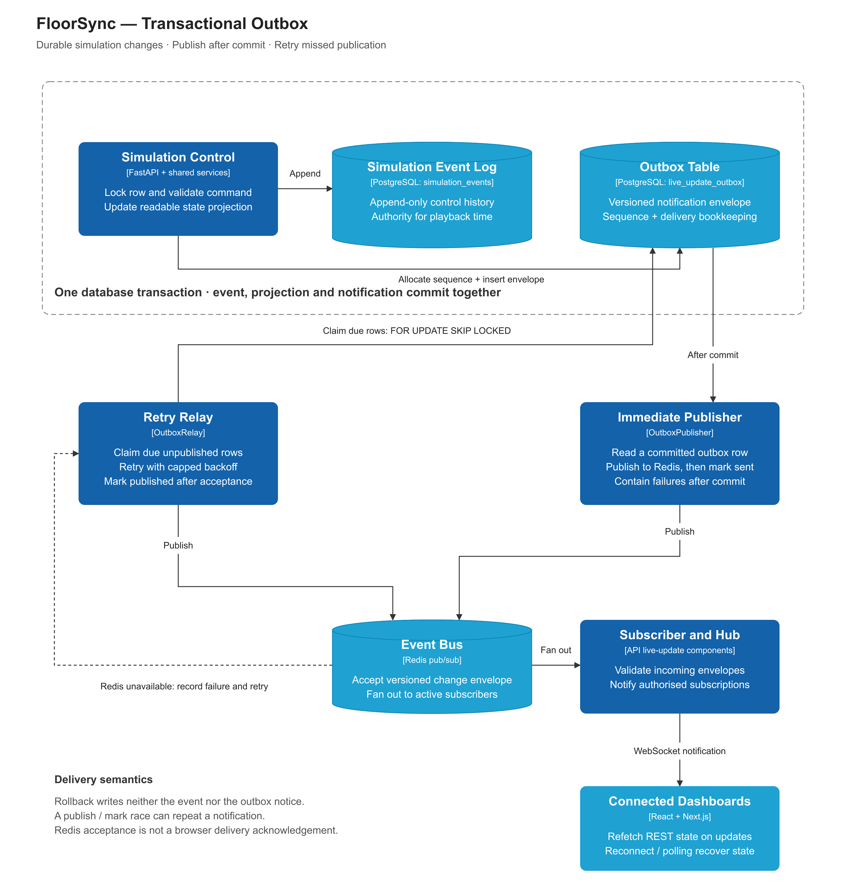

# Decision: Announce simulation changes through a transactional outbox with a versioned envelope

## Date

2026-09-16

## Status

Accepted. The durable half of #148 (contract, outbox, sequence allocation) landed first; the
transport half (tickets, WebSocket protocol, Redis publisher, subscriber and relay) is built
against it and recorded under Consequences.

## Diagram

[Editable draw.io source](../diagrams/sources/transactional-outbox.drawio).

For request ordering and retry failures, see the [simulation/live-update sequence](../diagrams/sequences/simulation-live-updates.png).

## Context

A manager's playback control is appended to `simulation_events` and the REST response reports the
new position (decision 0010). Every other open dashboard, the manager's and each operator's, still
only finds out by asking again. #148 asks for a push: the API tells every connected client within
a second that the simulation changed, and the client seeks its local clock to the new anchor.

The push path is Redis pub/sub and a WebSocket per browser. Both can lose or duplicate a message,
and neither is a place to keep truth. The question this decision settles is how a change is
recorded so that a lost message is recoverable, how clients tell old from new, and what exactly
crosses the wire.

## Decision

1. **The change and its notification commit together.** `LiveUpdateOutboxService
   .enqueue_simulation_change` writes one `live_update_outbox` row inside the transaction that
   recorded the control (or created the simulation). If the transaction rolls back, neither exists.
   The route publishes the row to Redis only after commit, and a relay retries any row still
   unpublished. Publishing is never allowed to fail a control.
2. **Every notification has a per-simulation sequence.** `simulations.live_sequence` counts the
   notifications a simulation has issued. It is allocated with a single `UPDATE ... RETURNING`, so
   two callers can never receive the same number even when they were not serialised by a row lock;
   `(aggregate_id, sequence)` is unique in the outbox as the database's own guarantee. A client
   discards a sequence at or below the last one it accepted and refetches the REST snapshot on a
   gap, so a duplicated, reordered or lost message can never make a client wrong.
3. **The payload is a versioned wire contract, not a serialised model.** `live_updates.contracts`
   defines `SimulationChangedEnvelope` (`v`, `topic`, `event_id`, `simulation_id`, `sequence`,
   `occurred_at`, `cause`, `snapshot`) and `SimulationAnchor` (`status`, `simulated_time`,
   `speed`, `makespan`, `observed_at`). `to_payload` and `from_payload` are the only encoders;
   `from_payload` refuses any version, topic, cause or field shape it cannot vouch for with
   `UnsupportedEnvelope`, because a payload may have come from another process over Redis.
4. **The envelope is audience-free.** It carries the common anchor only. Whether a recipient gets
   the whole floor or one machine's detail is decided by the API at delivery time, per
   subscription, never by the row and never by the browser.
5. **`event_id` is the outbox row id.** The row the relay retries, the message on the channel and
   the frame a client deduplicates are one identity.
6. **Creating a simulation is a change too.** It appends no `simulation_events` row, so it is
   announced with `cause="created"` and sequence 1 straight after the insert is flushed. The cause
   vocabulary is therefore the event types plus `created`, kept as its own literal rather than
   reusing `SimulationEventType`.
7. **`aggregate_id` is not a foreign key.** The outbox is generic over topics and records a
   notification owed, not part of the simulation's history. Uniqueness on `(aggregate_id,
   sequence)` is the invariant that matters. `payload` is the schema's one JSONB column: written
   once, read whole, never queried by field.
8. **The relay's read gets a partial index.** `(next_attempt_at, created_at) WHERE published_at IS
   NULL` is the relay's only query, and the index stays the size of the backlog rather than the
   history. This narrows the ticket's `(published_at, next_attempt_at, created_at)` to the rows
   that are ever read.
9. **Delivery bookkeeping lives beside the write.** Every other read and write of the outbox is a
   `LiveUpdateOutboxService` method too, so the API's publisher, relay and health signal hold
   Redis and sockets but no SQL. `claim_due` locks due rows with `FOR UPDATE SKIP LOCKED`, so
   several relays never hold the same row and never wait on each other. `mark_published` only
   marks a row that is still unpublished, so when the immediate publisher and a relay both send a
   row, exactly one of them records it and the other is told it was already settled. The client
   discards the duplicate message by `event_id` and `sequence` (decision 2). `record_failure`
   stores the retry time the relay chose; the backoff policy stays with the relay.

## Rationale

Decision 1 is the transactional outbox pattern: the database is the only thing that has to be
reliable, and it already is. Decision 2 makes the client's job mechanical (compare integers)
instead of semantic (compare timestamps, which the same second can share). Decision 3 is the same
argument as `docs/api-conventions.md` makes for HTTP schemas: the frontend builds against the
wire shape, so a column rename must not reach it. Decision 4 keeps a confidential floor view out
of every operator's browser, which a frontend-side filter cannot promise.

## Alternatives considered

- **Publish to Redis from the route and skip the outbox.** Simpler, and the client refetches on a
  gap anyway. Rejected for now because a message lost while Redis is down is not a gap the client
  can detect: it sees silence, which is what a running simulation with no controls also looks
  like. Whether the relay is required for the first release is still an open question for the
  team; the outbox row costs nothing if the relay comes later.
- **Derive the sequence from `max(sequence) + 1` in the outbox instead of a counter column.**
  Avoids a second place that knows the count. Rejected because it needs the row lock to be
  correct, so a caller that forgot the lock would get an integrity error under concurrency
  instead of a unique number; the counter with `UPDATE ... RETURNING` is correct on its own.
- **Reuse `SimulationEventType` for `cause`.** Rejected because `created` is not an event and the
  cause is a wire value, not a database one.
- **Redis Streams instead of pub/sub.** Streams persist and replay, which would make the outbox
  redundant. Rejected because it moves durability from the database, which every other decision
  trusts, to Redis, which none does.

## Consequences

- New package `floorsync_common.live_updates` (`contracts` pure, `results`, `service`), model
  `LiveUpdateOutbox`, column `simulations.live_sequence`, migration `20260916_0002`.
- The route that records a control calls `enqueue_simulation_change` inside the same `db.begin()`
  and only publishes after it commits (`create_simulation` and `create_simulation_event` in the
  simulation router). `OutboxPublisher.publish_now` then reads and marks the row, each in its own
  explicit transaction: sessions are `autobegin=False`, so a statement outside a `begin()` raises,
  and the publisher runs after the route's transaction has closed.
- Delivery lives in the API (`api/features/live_updates`): one-time Redis tickets, the `/ws`
  protocol, a per-process `ConnectionHub` keyed by `(simulation, audience, machine)`, one Redis
  subscriber per process, and an `OutboxRelay` that retries rows the immediate publish missed. None
  of them holds SQL; they call `LiveUpdateOutboxService`. A row whose payload no subscriber would
  accept is not published: the relay parks it for the longest backoff with
  `last_error_code = 'UnsupportedEnvelope'`, and a subscriber that still receives one drops it with
  an error log carrying the event id and counts it (`/health/live-updates`).
- Redis hanging is handled like Redis being down, not left to the operating system's timeout. The
  command client (publish, tickets, rate limits, health) connects and reads with
  `REDIS_SOCKET_TIMEOUT_SECONDS`; the subscriber has its own client without the read timeout (a
  subscription is idle between messages) and relies on keepalive and health checks instead. A
  ticket request answers 503 so the frontend can fall back to polling, a socket handshake closes
  1013, and the relay ends its batch at the first Redis failure rather than waiting out a timeout
  per row while holding their locks.
- Redis being down never fails a control and never makes the API unready. `/health/live-updates`
  reports degraded delivery separately from `/health/ready`.
- For the first release the subscriber and the relay run in the API's lifespan. Before the API is
  scaled out, run the relay as its own supervised process or worker: several relays are safe
  (`SKIP LOCKED`), but a relay per API replica polls the database once per replica for no gain.
- `record_control` locks the simulation row (`queries.lock_simulation`, `SELECT ... FOR UPDATE`)
  before validating a control, so two managers pressing buttons at once are applied one after the
  other against the status the previous one left, and sequence order matches event order. Reads
  (`get_simulation`) do not lock, so a dashboard poll never queues behind a control.
- The guarantees above that only Postgres can give (decision 1's shared commit and rollback, the
  row lock, `SKIP LOCKED`, first-writer-wins marking) are proven against a real database in
  `tests/integration/test_live_update_outbox.py` (`make test-integration`); the route, publisher
  and relay run end to end against it in `test_live_update_delivery.py`, and surviving a Redis
  restart is proven in `test_live_update_restart.py`.
- Published rows accumulate. Retention is a separate maintenance task and must not precede
  delivery verification (#148).
- Bumping `ENVELOPE_VERSION` is a breaking change for every subscriber; adding an optional field
  is not.
