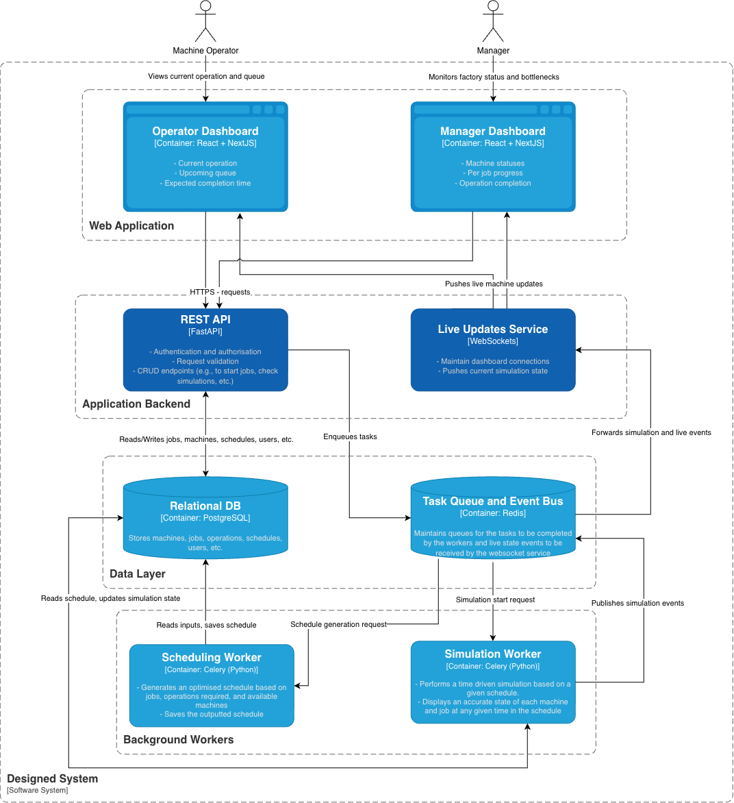
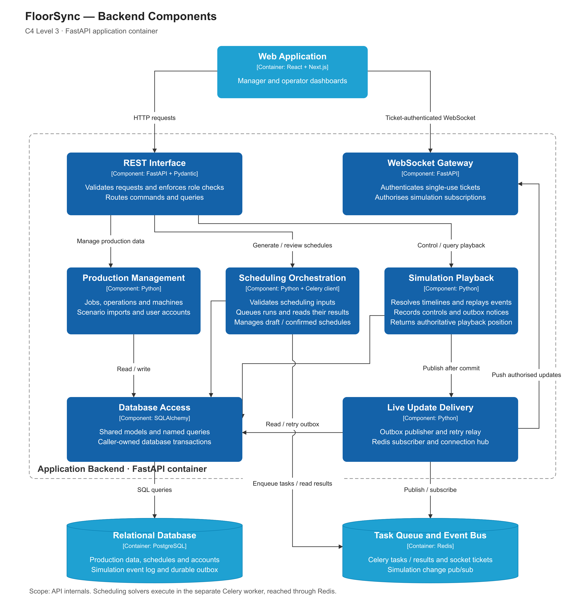
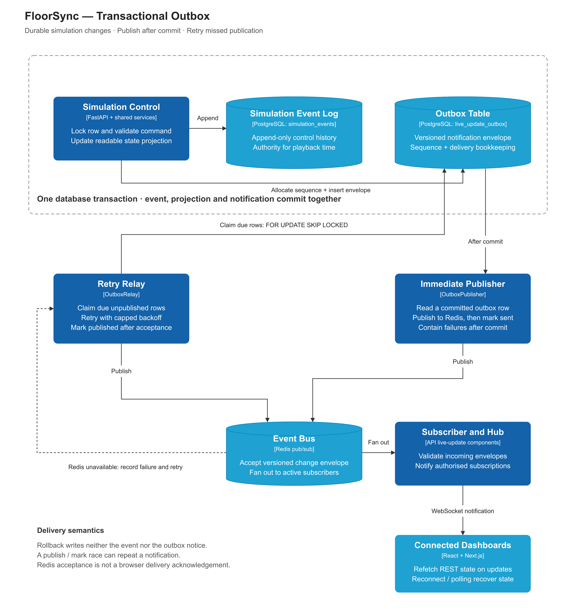
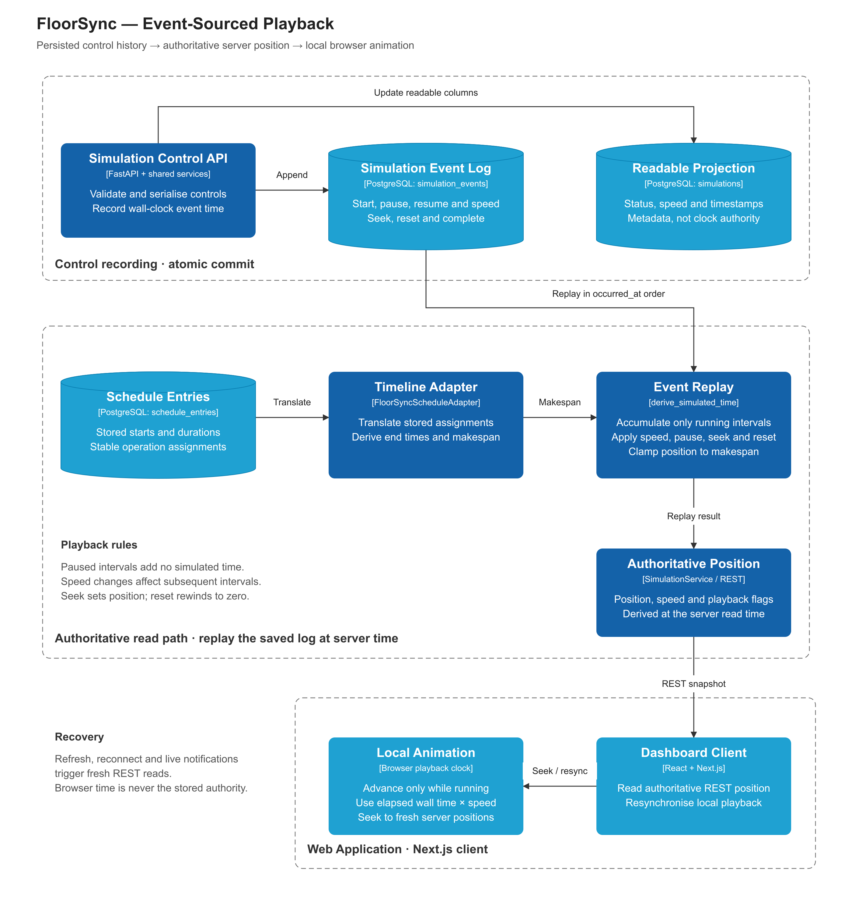
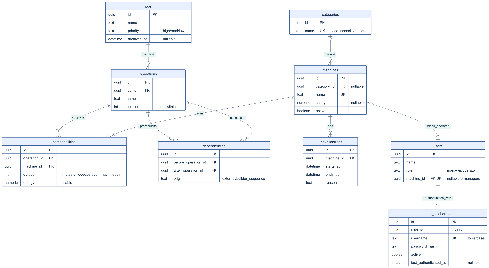
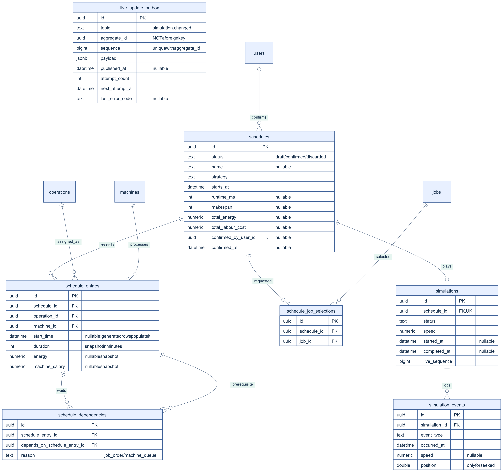
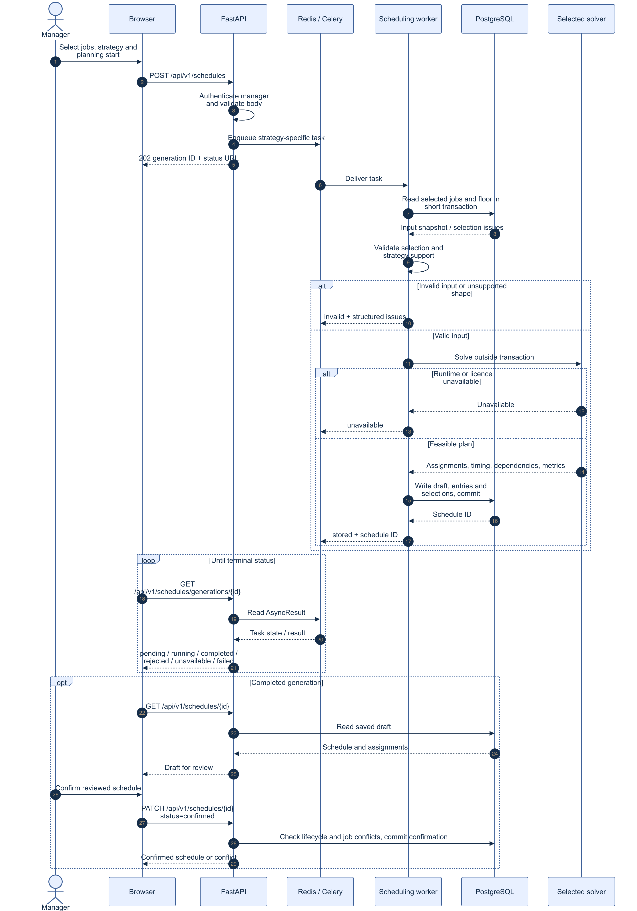
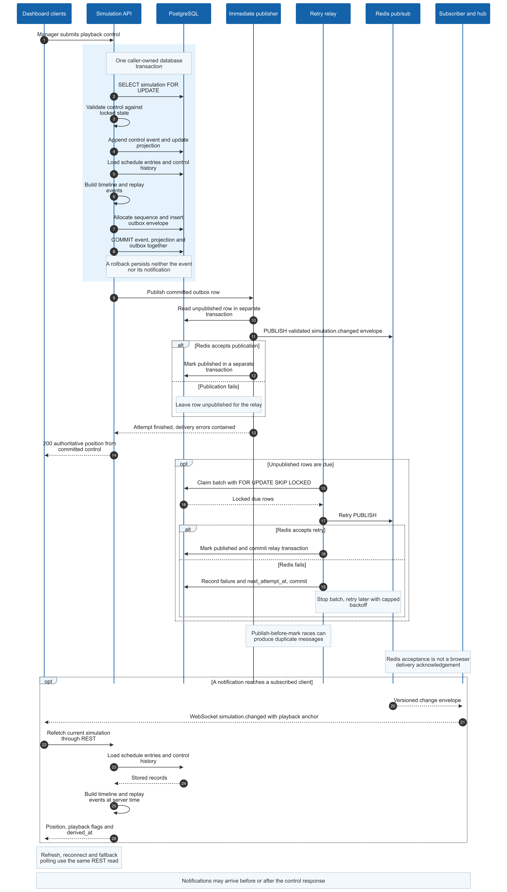

# FloorSync system diagrams

8 diagrams cover the system architecture, backend components, reliability and playback patterns, data model and key runtime flows. Final PNG images are embedded in the relevant documentation; Editable sources are kept alongside this catalogue.

## Organisation

| Folder | Contents |
| --- | --- |
| [architecture/](architecture/) | Supplied system architecture and backend component images. |
| [patterns/](patterns/) | Transactional outbox and event-sourced playback images. |
| [data/](data/) | Production/account and schedule/simulation ERDs, plus the existing detailed schema references. |
| [sequences/](sequences/) | Schedule-generation and simulation/live-update sequences. |
| [sources/](sources/) | Editable draw.io and Mermaid files. |

The supplied system architecture image is preserved unchanged. Component and pattern views describe the inspected backend implementation in more detail.

## Diagram index

| Diagram | Used in | Editable source |
| --- | --- | --- |
| [System architecture](#floorsync-architecture) | [Architecture](../architecture.md) | Supplied PNG |
| [Backend components](#floorsync-backend-components) | [Architecture](../architecture.md) | [draw.io](sources/backend-components.drawio) |
| [Transactional outbox](#floorsync-transactional-outbox) | [Outbox decision](../decisions/0017-live-update-outbox.md) | [draw.io](sources/transactional-outbox.drawio) |
| [Event-sourced playback](#floorsync-event-sourced-playback) | [Playback decision](../decisions/0010-event-sourced-simulated-time.md) | [draw.io](sources/event-sourced-playback.drawio) |
| [Production and account data](#production-data-erd) | [Database schema](../database-schema.md) | [Mermaid](sources/production-data-erd.mmd) |
| [Schedules, simulation and delivery data](#schedule-simulation-erd) | [Database schema](../database-schema.md) | [Mermaid](sources/schedule-simulation-erd.mmd) |
| [Generate and review a schedule](#schedule-generation-sequence) | [Scheduling design](../scheduling.md), [Scheduling and simulation backend](../scheduling-simulation-backend.md) | [Mermaid](sources/schedule-generation.mmd) |
| [Simulation control and durable live updates](#simulation-live-updates-sequence) | [Scheduling and simulation backend](../scheduling-simulation-backend.md), [Outbox decision](../decisions/0017-live-update-outbox.md) | [Mermaid](sources/simulation-live-updates.mmd) |

## System architecture

FloorSync architecture diagram supplied by the team.

[PNG](architecture/system-architecture.png)

## Backend components

A closer view of the FastAPI container: REST and WebSocket entry points, production management, scheduling orchestration, simulation playback, database access and live-update delivery. Next.js, PostgreSQL and Redis remain outside this container. The scheduling solver runs in the separate worker. Components group related implementation modules; transport glue and routine dependencies are simplified.

[PNG](architecture/backend-components.png) · [Editable draw.io source](sources/backend-components.drawio)

## Transactional outbox

The control event, readable simulation projection and outbox notification commit in one database transaction. Immediate publishing and the retry relay run after that commit. Redis acceptance marks publication, not browser receipt. Clients refetch REST state when notified.

Decision: [ADR 0017 · Transactional outbox and versioned notifications](../decisions/0017-live-update-outbox.md).

[PNG](patterns/transactional-outbox.png) · [Editable draw.io source](sources/transactional-outbox.drawio)

## Event-sourced playback

Control history is the authority for simulated time. The server replays saved events against the schedule makespan at read time. Stored status and speed are a readable projection. The browser animates between fresh authoritative REST positions and resynchronises after refresh, reconnect or live notifications.

Decision: [ADR 0010 · Event-sourced simulated time](../decisions/0010-event-sourced-simulated-time.md).

[PNG](patterns/event-sourced-playback.png) · [Editable draw.io source](sources/event-sourced-playback.drawio)

## Production and account data

Key fields are shown; all tables also have UUID identifiers and timestamp mixins. Compatibility owns machine-specific operation duration. Operation.position is display order; Dependency owns precedence, including cross-job edges. An operator must have one machine; a manager must have none.

[PNG](data/production-data-erd.png) · [Editable Mermaid source](sources/production-data-erd.mmd)

## Schedules, simulation and delivery data

Key fields are shown; dashed associations to the outbox are intentionally absent: aggregate_id is not a foreign key. A schedule has at most one simulation. Generated assignment duration and cost are snapshots; end times and machine queue positions are derived. See the production ERD for jobs, operations, machines and users.

[PNG](data/schedule-simulation-erd.png) · [Editable Mermaid source](sources/schedule-simulation-erd.mmd)

## Generate and review a schedule

The API returns before solving. Each worker read/write transaction is short; inference holds no database transaction. A successful result is a draft that requires a separate manager confirmation. Exact solver time limits can return a feasible plan without proving optimality.

[PNG](sequences/schedule-generation.png) · [Editable Mermaid source](sources/schedule-generation.mmd)

## Simulation control and durable live updates

Shows the shared control/outbox commit, a best-effort immediate publication, independent relay retries with SKIP LOCKED, and authoritative REST recovery. Publish/mark races can repeat notifications. The current browser refetches on updates rather than applying event deltas; notifications may arrive before or after the control response.

[PNG](sequences/simulation-live-updates.png) · [Editable Mermaid source](sources/simulation-live-updates.mmd)

## Detailed schema references

The earlier [physical schema](data/physical-schema.png) and [schedule-storage design](data/schedule-storage-design.png) are retained as supporting references in the data folder. The two focused ERDs above are the overview views used in the documentation.

## Maintenance

Edit draw.io files in `sources/` and export the corresponding PNG into the diagram's category folder. Edit Mermaid files in `sources/` and regenerate their PNG exports. Keep the PNGs committed so Markdown viewers do not need a diagram renderer. The supplied architecture is available as a PNG only.
