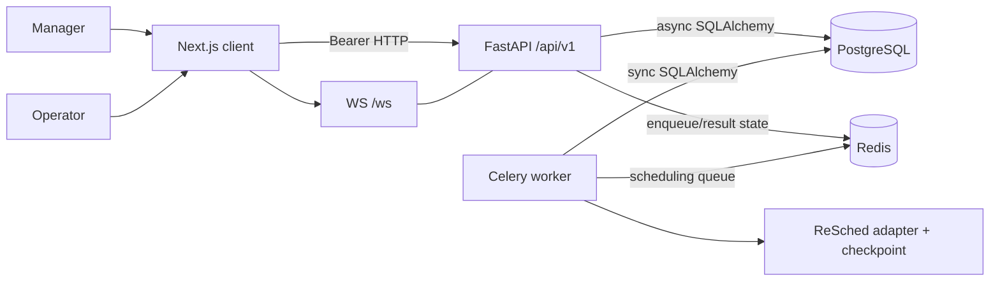
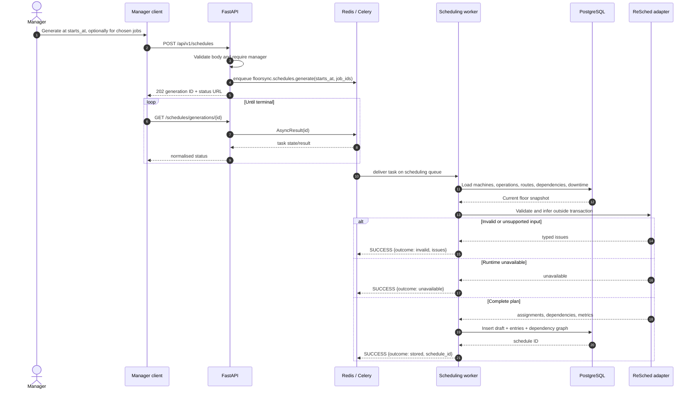
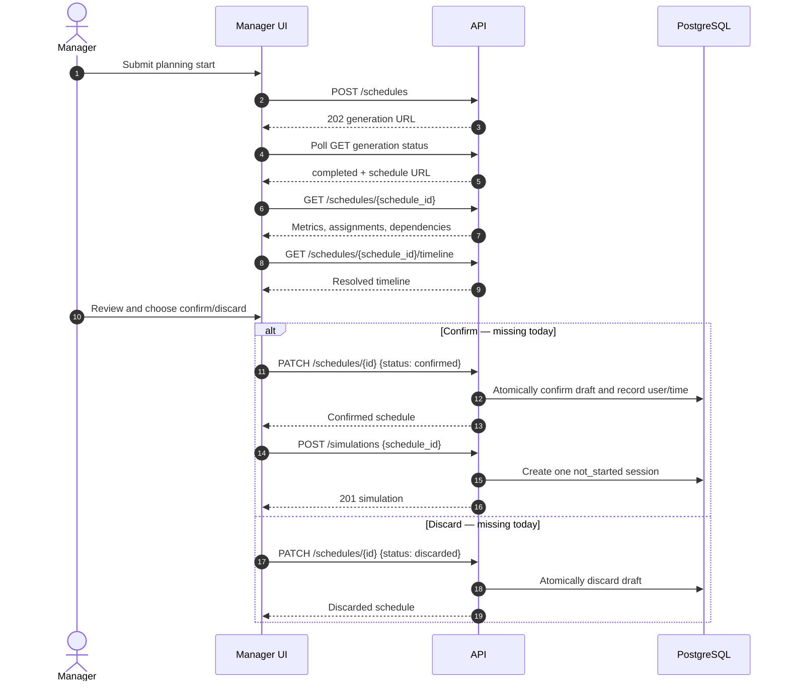
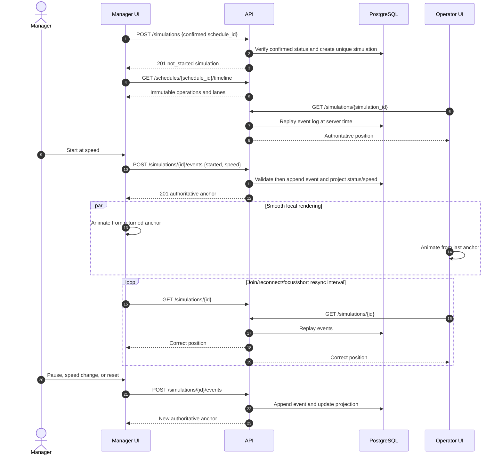

# Scheduling and simulation backend

This is the implementation reference for FloorSync's scheduling and simulation request flows. It records the code that exists today, identifies the seams that prevent the intended user journey, and defines the required client/server interactions.

## Scope and vocabulary

- A **schedule** is an immutable generated assignment of operations to machines. Its lifecycle is `draft` → `confirmed` ⇄ `discarded`; a draft is deleted, never discarded (decision 0015).
- A **timeline** is the calculated earliest-feasible placement of schedule entries on the schedule clock. It is derived, never stored.
- A **simulation** is the shared, persistent playback session for one confirmed schedule.
- A frontend **plan** is currently an in-memory browser object. It is not a backend `Schedule` and is lost on reload.
- Generated timeline duration is in minutes. Simulation-control timestamps are real UTC wall-clock instants.

The findings below come from the API routes, Celery task, scheduling/simulation services and ORM models, tests, frontend API client, and pages in this repository (reviewed 9 September 2026).

## Architecture



| Area | Owner | Responsibility |
| --- | --- | --- |
| `floorsync_api.features.schedules` | API | Authenticate/authorise, enqueue requests, expose generation state and saved schedules. |
| `floorsync_workers.tasks.schedules` | worker | Snapshot floor input, infer outside a DB transaction, persist a new draft. |
| `floorsync_common.scheduling` | shared core | Validate the supported FJSP shape, adapt ReSched output, calculate metrics and store drafts. |
| `floorsync_api.features.simulation` | API | Expose timeline reads and map simulation commands/outcomes to HTTP. |
| `floorsync_common.simulation` | shared core | Resolve schedule graph into a timeline and replay an event log into an authoritative position. |
| frontend | browser | Draw Gantt data and animate smoothly between authoritative server positions. |

`GET /health` and `WS /ws` are outside `/api/v1`. The WebSocket currently accepts every connection and emits only `{"type":"connected"}`; it is not yet an authenticated update channel.

## Data model and invariants

| Resource | Important fields | Invariant |
| --- | --- | --- |
| `schedules` | status, strategy, metrics, confirmation audit fields | A successful worker run creates a new `draft`; it does not overwrite older schedules. A draft can be deleted; a confirmed schedule cannot, and blocks removal of the jobs it planned (decision 0015). |
| `jobs` | name, priority, `archived_at` | `archived_at` is set only by a manager. A job's `backlog_status` (`open`, `planned`, `done`, `archived`) is derived from the confirmed schedules that plan it and their simulations, never stored (decision 0019). Archived, planned and done jobs are refused by generation and are read-only (`409 job-has-left-backlog`); only an open job can be edited. |
| `schedule_entries` | operation, chosen machine, duration, energy, machine salary | One entry per operation per schedule; route/cost data are generation-time snapshots. |
| `schedule_dependencies` | waiting entry, prerequisite entry, `job_order` / `machine_queue` | The graph used to calculate the timeline. References must belong to the same schedule. |
| `simulations` | unique schedule, status, speed, timestamps | At most one simulation for each schedule. Status/speed are a projection, not the clock authority. |
| `simulation_events` | type, occurred time, optional speed | Append-only source of truth for playback time. |

Timeline resolution is a topological longest-path calculation over entries and dependencies. It throws on a cycle or inconsistent graph instead of inventing a start time. Playback replays every control event at read time; it never derives position from `started_at + speed` alone because that would continue advancing while paused.

## Current HTTP surface

Every product endpoint requires a bearer token. Manager-only access applies to generation, full schedule access, simulation creation, and controls. Any signed-in user may currently read timelines and simulation positions.

| Endpoint | Role | Current response |
| --- | --- | --- |
| `POST /api/v1/schedules` | manager | Queues `{starts_at, job_ids, strategy?}` and returns `202`, a generation ID, and `Location`/`status_url`. `job_ids` is required with at least one entry (#270); the selection is validated in the worker rather than here (decision 0013), and an archived, planned or done job is refused there (`archived_job`, `planned_job` naming the schedule). |
| `GET /api/v1/jobs/dependency-graph` | manager | Every cross-job precedence edge, so a caller can work out what selecting a job implies before scoping a run. |
| `GET /api/v1/schedules/validation` | manager | `{schedulable: {resched, exact}, issues, warnings, unsupported}` for the required `?job_ids=...` selection. Always `200`; writes nothing. Issues stop every strategy and name their record; warnings (empty job, idle machine) stop nothing; unsupported is per strategy. |
| `GET /api/v1/schedules/generations/{id}` | manager | `pending`, `running`, `completed`, `rejected`, `unavailable`, or `failed`. Completion supplies a schedule link; rejection supplies issues. |
| `GET /api/v1/schedules` | manager | Every schedule summary, newest first; currently unpaginated. |
| `GET /api/v1/schedules/{id}` | manager | Metadata plus all entries and dependencies. |
| `DELETE /api/v1/schedules/{id}` | manager | Removes a draft and everything under it, `204`. A confirmed or discarded schedule answers `409 schedule-is-not-draft`. |
| `PATCH /api/v1/schedules/{id}` | manager | `{"status": "confirmed"}` makes a draft the plan (records `confirmed_by_user_id`, `confirmed_at`) or restores a discarded one; `{"status": "discarded"}` withdraws a confirmed schedule. Repeating the current status is a no-op `200`. A draft answers `409 schedule-is-draft` (delete it instead); a schedule whose simulation has recorded a control answers `409 schedule-simulation-started`; a never-controlled simulation is removed with the withdrawal. |
| `GET /api/v1/schedules/{id}/timeline` | signed-in user | Gantt-ready, derived timeline. It currently permits drafts as well as confirmed schedules. |
| `POST /api/v1/simulations` | manager | Creates one simulation for a confirmed schedule; `201` with `Location`. |
| `GET /api/v1/simulations/{id}` | signed-in user | Authoritative position, replayed at server time. |
| `POST /api/v1/simulations/{id}/events` | manager | Appends a control event and returns its derived position. |

Write contracts reject unknown fields. Errors map to RFC 9457 Problem Details. Queue connection failures specifically return `503` without leaking broker details.

### Generation status

| Status | Meaning | Client behaviour |
| --- | --- | --- |
| `pending` | Task has not started, or result backend has no terminal value. | Poll with bounded backoff. |
| `running` | Worker claimed the request. | Continue polling; never duplicate-submit. |
| `completed` | A draft was saved. | Fetch, review, then confirm or discard. |
| `rejected` | Current input cannot be represented by the adapter. | Show structured issues and correct data. |
| `unavailable` | ReSched runtime, submodule, or checkpoint is unavailable. | Show operational failure; a data retry will not fix it. |
| `failed` | Worker crashed or result had an unexpected shape. | Show generic error and retain task ID for support. |

### Simulation transition table

| Event | Valid projected state | Required field | New projected state |
| --- | --- | --- | --- |
| `started` | `not_started` | positive `speed` | `running` |
| `paused` | `running` | none | `paused` |
| `resumed` | `paused` | positive `speed` | `running` |
| `speed_changed` | `running`, `paused` | positive `speed` | unchanged |
| `reset` | any | none | `not_started` |
| `completed` | `running` | none | `complete` |

The code checks that speed is supplied when required, but it does not yet reject zero/negative values at the request or database boundary. Such an event is persisted and later makes replay fail.

## Existing scheduling request flow

The API intentionally does not run inference. The worker reads input in a short transaction, closes it, runs the pure adapter, then opens a new transaction only to store a result.



Data coherence is checked once, in `scheduling/input_checks.py`, before either engine runs: positive durations, non-negative energy, unique IDs/routes/dependencies, known references, a timezone-aware start, at least one operation, an active compatible route for each operation, and no cycle (each operation in a cycle is named). The ReSched adapter additionally supports conventional flexible job-shop chains only, so it rejects downtime windows, fan-in/fan-out, and any dependency graph that is not disjoint linear chains; the exact solver rejects downtime windows only. Both worker tasks apply their strategy's limits through `validate_for_strategy` before adapting the input, so the exact task refuses downtime windows rather than silently dropping them. No partial schedule is persisted on rejection. `GET /api/v1/schedules/validation` runs the same checks on demand and reports, per strategy, whether a generation would succeed (#133).

## Required user flow: generate, review, confirm, simulate

The required product flow has an explicit confirmation boundary. Generation produces a draft, not authority to start a persistent simulation. A draft is thrown away with `DELETE /api/v1/schedules/{id}` and confirmed with `PATCH /api/v1/schedules/{id}` `{"status": "confirmed"}` (decision 0015, #268); only a confirmed schedule can reach `POST /simulations`. A confirmed schedule the floor has not acted on can be withdrawn with `{"status": "discarded"}` and confirmed again later.

Refusals that a schedule causes elsewhere name it: `DELETE /jobs/{id}`, `DELETE /operations/{id}` and a definition save that removes a scheduled step all answer `409` with `draft_schedule_ids` (delete those and retry) and `confirmed_schedule_ids` (history; archive the job instead with `PATCH /jobs/{id}` `{"archived": true}`).



Recommended public contract:

```http
PATCH /api/v1/schedules/{schedule_id}
Content-Type: application/json

{"status":"confirmed"}
```

Managers should be able to transition only `draft -> confirmed` or `draft -> discarded`. Confirmation must write `confirmed_by_user_id` and `confirmed_at`; any other transition should receive `409`. Use a conditional update or row lock so competing managers cannot reach different terminal states.

## Required shared simulation flow

The backend already supports event-sourced shared playback. The current browser consumes only the timeline endpoint and instead drives `setInterval` locally; it does not create simulations or post events. Replace that split with the flow below.



Client rules:

1. Fetch the timeline once per selected schedule; never poll it for frames.
2. Create a simulation after confirmation, and treat an existing-session `409` as an invitation to open that session—not to create another.
3. Use every control response as the clock anchor. Do not send browser elapsed time back as authority.
4. On join/reconnect, read `GET /simulations/{id}` and seek the local player to that value.
5. At or beyond the returned makespan, render complete and permit a new run only after `reset`.

## Issues and remediation

| Priority | Finding | Evidence and user impact | Remediation |
| --- | --- | --- | --- |
| Done | Confirmation/discard endpoint | `PATCH /api/v1/schedules/{id}` with `status` (#268). | Frontend wiring is #271. |
| P0 | Frontend bypasses backend lifecycle | Scheduler generates a browser plan; simulation reads timeline but plays via a local React interval. The frontend API client lacks generation/control calls. | Wire queue/poll/review/confirm/create/control flow; mark the local planner as preview until replaced. |
| P1 | Snapshot happens at worker start, not request acceptance | Queue command contains only `starts_at`; the worker loads the configuration when it claims the task. A changed floor can yield a different plan from the one the manager requested. | Persist a generation request and input snapshot before enqueueing; publish via an outbox. |
| P1 | Concurrent simulation commands can race | Create and control services check state then write without a row lock. Concurrent calls can both pass a transition test or collide on the unique schedule ID. | Lock the schedule/simulation row; catch unique violation and return a deterministic `409`; test concurrent create/play. |
| P1 | Non-positive speed is accepted | Presence is validated but `Decimal <= 0` is not. Replay then raises an invariant error. | Apply `gt=0` request validation and DB checks to event/simulation speed. |
| P1 | WebSocket is not safe or useful for state delivery | `/ws` has no authentication or subscriptions and sends only `connected`. | Use authenticated polling until subscriptions and authorisation are implemented, then publish control/task events. |
| P2 | Generation state is only a Celery result | No durable requester/snapshot/history record; result expiry can make a completed request look pending. | Persist status, submitter, timestamps, outcome/issues, and schedule ID in PostgreSQL. |
| P2 | Schedule list is unpaginated | It returns all rows despite the project API convention requiring cursor pagination for growing collections. | Add `limit`/cursor with stable `(created_at, id)` ordering. |
| P2 | Timeline access policy is ambiguous | Code permits any signed-in user and drafts; documentation repeatedly describes confirmed-schedule playback. | Decide and enforce: managers review drafts; authorised viewers play confirmed schedules, or explicitly document broad access. |
| P2 | Resolver invariant failures are not mapped at the HTTP edge | A cyclic/mismatched stored graph can propagate as a generic server error. | Return stable client-safe Problem Details with private contextual logs. |
| P3 | Existing scheduling prose overstates calendar support | The code rejects every unavailability window. | Describe downtime as unsupported until a calendar-aware scheduler/projection exists. |
| P3 | Joining a known existing simulation is awkward | One simulation is unique per schedule but no schedule-to-simulation lookup exists, and event rows do not identify the actor. | Return existing resource details on conflict or add `GET /schedules/{id}/simulation`; add actor metadata if audit is required. |

## Delivery order

1. Add schedule confirmation/discard and connect frontend generation, polling, review, and confirmation.
2. Connect frontend simulation creation/events; add positive speed validation and row locking.
3. Persist generation requests/snapshots/outcomes and use an outbox for reliable task publication.
4. Add pagination, reliable join/discovery, and authenticated realtime updates or bounded polling.
5. Only then add downtime-aware scheduling, disruption events, or rescheduling as a new draft version—not a mutation of a confirmed plan.

## Verification checklist

- A manager submits once, observes `pending`/`running`, and opens exactly the completed draft linked by the result.
- Unsupported graph shape or downtime creates no schedule rows and returns structured rejection issues.
- An operator cannot generate, change lifecycle, create simulations, or record controls; authorised viewers can read a confirmed timeline and position.
- A draft transitions once; a discarded schedule cannot be simulated.
- A second create reaches the existing shared simulation deterministically.
- Pause freezes time; resume/speed change affect only future time; reset goes to zero; invalid speed is rejected before persistence.
- Competing control requests cannot produce an impossible event sequence.
- Late-joining viewers resolve the same timeline and authoritative position.
- Worker failure, Redis loss/result expiry, and malformed stored graph return documented safe client errors and actionable private logs.

## Related material

- [Scheduling design](scheduling.md)
- [Simulation package reference](../src/backend/common/floorsync_common/simulation/README.md)
- [Architecture](architecture.md)
- [API conventions](api-conventions.md)
- [Derived timeline decision](decisions/0009-derived-simulation-timeline.md)
- [Event-sourced simulated time decision](decisions/0010-event-sourced-simulated-time.md)
