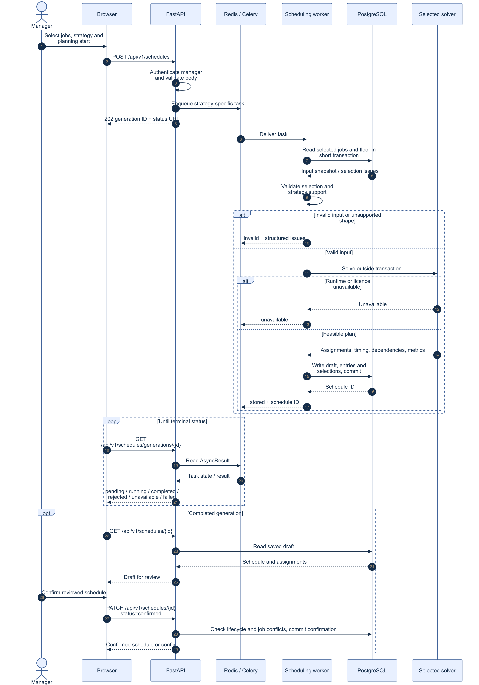

# Scheduling design

FloorSync is a **flexible job-shop scheduling** problem: each operation can have multiple compatible
machines, each option can have a different processing duration, operations are connected by a
dependency DAG, and a machine can do at most one operation at a time. Known maintenance/reservation
windows are hard calendar constraints.

The production dispatch policy is based on the MIT-licensed
[ReSched](https://github.com/XiangjieXiao/ReSched) REINFORCE FJSP implementation. FloorSync keeps
the model's operation-machine decision policy separate from its own validation, calendar-aware
feasibility projection and schedule-version persistence. This prevents an ML inference result from
ever bypassing production constraints.

## Generation flow

Generation runs asynchronously and creates a draft for review. The worker loads an input snapshot, runs the chosen solver outside a database transaction, then saves the result in a new transaction. Confirmation is a separate manager action.

[Editable Mermaid source](diagrams/sources/schedule-generation.mmd).

## Scheduling contract

The engine receives an immutable `SchedulingInput`, assembled in one database transaction from:

| Input | Source | Meaning |
| --- | --- | --- |
| Operations | `operations` | Work that must be assigned exactly once. |
| Routes | `compatibilities` | Allowed operation-machine pairs, each with duration and energy. |
| Precedence | `dependencies` | Directed `before -> after` hard constraints, including cross-job assembly dependencies. |
| Resources | active `machines` | One capacity unit per machine and its cost per minute. |
| Calendar blocks | `unavailabilities` | Intervals that no operation may overlap. |
| Planning origin | generation request | Timezone-aware timestamp from which the schedule may begin. |

The engine returns either a complete `SchedulePlan` or a typed `SchedulingInputInvalid` result.
It never emits or persists a partial plan. Validation reports duplicate IDs/edges, unknown
references, missing active routes, non-positive durations, invalid downtime and dependency cycles
before placement begins.

## ReSched adapter

`ReSchedEngine` converts a standard FloorSync job-shop input into ReSched's FJSP duration,
dependency and operation-machine tensors, runs greedy inference with the bundled `Old-SD1-10x05`
REINFORCE checkpoint, then maps ReSched's output directly to FloorSync assignments and metrics:

1. Validate the full input and reject cycles or unroutable operations.
2. Require disjoint, linear operation chains; the adapter derives each ReSched job and operation
   position from those chains.
3. Run ReSched unchanged and translate its chosen machine plus start/end offsets to FloorSync UUIDs
   and timestamps.
4. Store ReSched's complete output as a draft schedule.

ReSched is trained for conventional FJSP inputs, so FloorSync deliberately rejects downtime windows,
fan-in/fan-out dependencies and any other non-linear job graph. It is safer to return a structured
validation error than silently alter a ReSched result with a second scheduling algorithm. Machine
counts unlike the selected checkpoint are permitted but must be evaluated before relying on quality.

Two kinds of check apply to an input, and they are kept apart (#133). *Data coherence* (an
operation nothing active can run, a non-positive duration, a precedence cycle, duplicate or
dangling references) is a property of the floor and lives once in `scheduling/input_checks.py`,
which imports nothing but the contracts and the pure graph helper;
both worker tasks run it before their engine, and `GET /api/v1/schedules/validation` runs it on
demand so a manager can see what is wrong before generating. *Strategy limits* (ReSched's linear
chains, neither engine's lack of downtime modelling) are a property of the engine and are reported
per strategy as *unsupported*, never as invalid: fan-in is legitimate data that the exact solver
takes (#216). A cycle names every operation caught in it, whichever path reports it.

The upstream code is tracked as `src/backend/third_party/ReSched` at a pinned git-submodule revision.
Install the learned runtime with `uv sync --extra resched`; this adds NumPy and a Python 3.12-
compatible PyTorch runtime (the upstream repository pins PyTorch 2.3.1). If the optional runtime or checkpoint is unavailable, the service returns
the explicit `ReSchedRuntimeUnavailable` outcome and writes no schedule.

## Persistence and API boundary

Each successful run becomes a new `draft` schedule; it never overwrites a confirmed schedule.
`schedules.strategy`, `runtime_ms`, `input_operation_count`, `makespan`, `total_energy` and
`total_labour_cost` form the run-history record. `schedule_entries` snapshots the selected route,
duration and machine cost.

`schedule_dependencies` records *why* an operation waits (`job_order` or `machine_queue`) and is
used with snapshotted durations to derive a schedule timeline when it is read.

`POST /api/v1/schedules` is manager-only and accepts a timezone-aware `starts_at`. It publishes a
`floorsync.schedules.generate` command to the `scheduling` Celery queue, then returns `202 Accepted`
with a `Location` pointing to `/api/v1/schedules/generations/{generation_id}`. The API process never
runs ReSched or holds a database transaction during inference.

The worker reads a configuration snapshot in a short transaction, closes it, runs the pure engine,
then persists the resulting draft in a separate short transaction. `GET` on the generation resource
reports `pending`, `running`, `completed`, `rejected`, `unavailable` or `failed`. A completed result
links to `GET /api/v1/schedules/{schedule_id}`, which retrieves the saved version, entries and
dependency graph. Rejected runs expose their machine-readable validation issues in the status
resource; queue outages are RFC 9457 `503` Problem Details. The engine itself remains database- and
FastAPI-free.

## Evaluation

Every scenario run records the snapshot size, strategy, runtime and metrics. Report makespan
(minutes), total energy, labour cost and runtime (ms), and compare those results with published or
separately generated FJSP benchmarks. Do not claim results for calendar- or DAG-extended inputs:
they are intentionally outside this adapter's supported contract.

Current scope is offline planning only. A machine failure after confirmation is a simulation/event
concern, not silent schedule repair; a later rescheduling feature should create a new draft from a
fresh snapshot.
